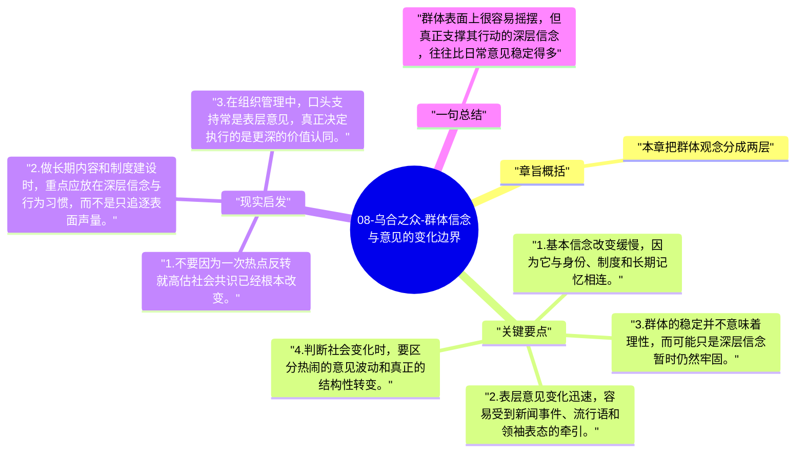

# 08-乌合之众-群体信念与意见的变化边界

勒庞在这一章讨论一个看似矛盾的问题：群体既容易被煽动，为什么有些信念又顽固得惊人。答案在于，群体内部同时存在缓慢变动的深层信念和快速波动的表层意见。

## 章旨概括

本章把群体观念分成两层。深层信念往往和文明结构、历史传统、价值秩序绑定，因此变化缓慢；表层意见则更容易随着事件、领袖和传播风向快速波动。理解这一点之后，就不会把每一次舆论反转都误以为价值根基已经被彻底改写。真正稳固的信念，需要长期条件变化才能撼动。

## 关键要点

1. 基本信念改变缓慢，因为它与身份、制度和长期记忆相连。
2. 表层意见变化迅速，容易受到新闻事件、流行语和领袖表态的牵引。
3. 群体的稳定并不意味着理性，而可能只是深层信念暂时仍然牢固。
4. 判断社会变化时，要区分热闹的意见波动和真正的结构性转变。

## 现实启发

1. 不要因为一次热点反转就高估社会共识已经根本改变。
2. 做长期内容和制度建设时，重点应放在深层信念与行为习惯，而不是只追逐表面声量。
3. 在组织管理中，口头支持常是表层意见，真正决定执行的是更深的价值认同。

## 一句总结

群体表面上很容易摇摆，但真正支撑其行动的深层信念，往往比日常意见稳定得多。

---

## Mermaid 思维导图

### 图1

