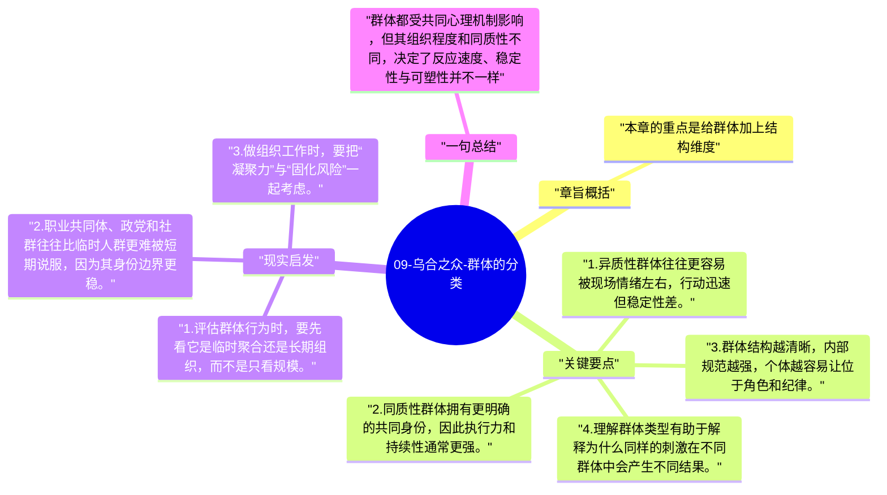

# 09-乌合之众-群体的分类

进入第三卷后，勒庞开始把前面的理论落到不同群体类型上。这一章先做总分类，说明不同群体虽然共享某些心理机制，但在组织程度、同质性和行动方式上仍有区别。

## 章旨概括

本章的重点是给群体加上结构维度。勒庞区分异质性群体和同质性群体，前者成员背景差异大，容易在短时间内被情绪牵引；后者则因共同身份、职业或信仰而更稳定、更有纪律，但也更容易固执。通过分类，勒庞说明群体心理不是一把尺子量到底，而要结合群体的内部组织程度来看。

## 关键要点

1. 异质性群体往往更容易被现场情绪左右，行动迅速但稳定性差。
2. 同质性群体拥有更明确的共同身份，因此执行力和持续性通常更强。
3. 群体结构越清晰，内部规范越强，个体越容易让位于角色和纪律。
4. 理解群体类型有助于解释为什么同样的刺激在不同群体中会产生不同结果。

## 现实启发

1. 评估群体行为时，要先看它是临时聚合还是长期组织，而不是只看规模。
2. 职业共同体、政党和社群往往比临时人群更难被短期说服，因为其身份边界更稳。
3. 做组织工作时，要把“凝聚力”与“固化风险”一起考虑。

## 一句总结

群体都受共同心理机制影响，但其组织程度和同质性不同，决定了反应速度、稳定性与可塑性并不一样。

---

## Mermaid 思维导图

### 图1

