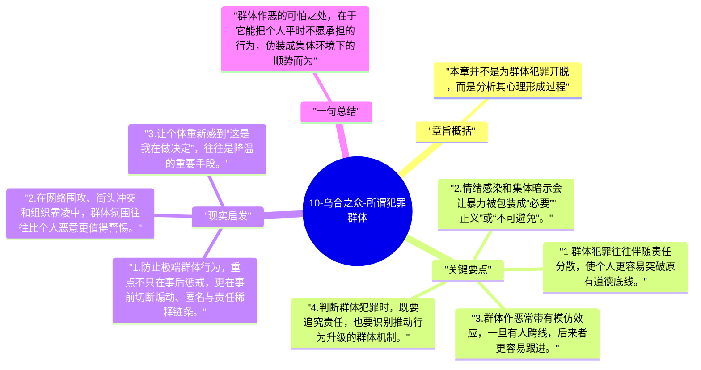

# 10-乌合之众-所谓犯罪群体

这一章讨论一个容易被情绪化理解的对象：犯罪群体。勒庞试图说明，群体作恶并不总是出于个人层面的恶意，而是特定情境、暗示和集体情绪共同推动的结果。

## 章旨概括

本章并不是为群体犯罪开脱，而是分析其心理形成过程。群体中的暴力行为常常带有感染、模仿和正当化机制，个人在其中不再以平时的伦理坐标思考，而是用“集体正在这样做”来稀释责任。勒庞因此提醒，人们必须把群体情境当作风险放大器，而不是仅仅把问题归因于少数坏人。

## 关键要点

1. 群体犯罪往往伴随责任分散，使个人更容易突破原有道德底线。
2. 情绪感染和集体暗示会让暴力被包装成“必要”“正义”或“不可避免”。
3. 群体作恶常带有模仿效应，一旦有人跨线，后来者更容易跟进。
4. 判断群体犯罪时，既要追究责任，也要识别推动行为升级的群体机制。

## 现实启发

1. 防止极端群体行为，重点不只在事后惩戒，更在事前切断煽动、匿名与责任稀释链条。
2. 在网络围攻、街头冲突和组织霸凌中，群体氛围往往比个人恶意更值得警惕。
3. 让个体重新感到“这是我在做决定”，往往是降温的重要手段。

## 一句总结

群体作恶的可怕之处，在于它能把个人平时不愿承担的行为，伪装成集体环境下的顺势而为。

---

## Mermaid 思维导图

### 图1

