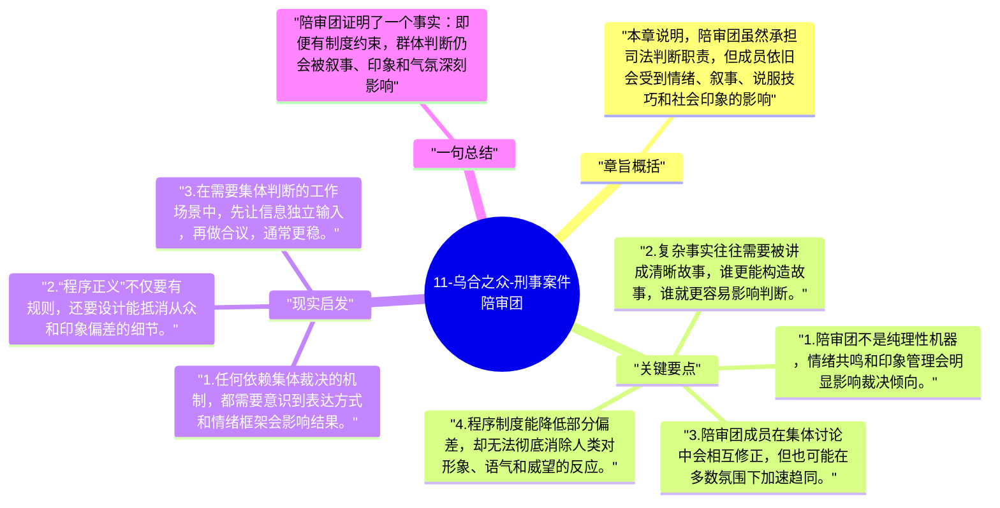

# 11-乌合之众-刑事案件陪审团

陪审团看似是程序化、制度化的群体，勒庞却指出它依然会呈现典型的群体心理。这一章因此很有现实意味：制度化并不会自动消除群体偏差，只会改变它的表现方式。

## 章旨概括

本章说明，陪审团虽然承担司法判断职责，但成员依旧会受到情绪、叙事、说服技巧和社会印象的影响。律师的形象、证词的表达方式、被告呈现出的样貌与姿态，都可能显著左右结论。勒庞借陪审团提醒读者，即便在强调事实和程序的场合，人类判断也难以完全摆脱群体心理的牵引。

## 关键要点

1. 陪审团不是纯理性机器，情绪共鸣和印象管理会明显影响裁决倾向。
2. 复杂事实往往需要被讲成清晰故事，谁更能构造故事，谁就更容易影响判断。
3. 陪审团成员在集体讨论中会相互修正，但也可能在多数氛围下加速趋同。
4. 程序制度能降低部分偏差，却无法彻底消除人类对形象、语气和威望的反应。

## 现实启发

1. 任何依赖集体裁决的机制，都需要意识到表达方式和情绪框架会影响结果。
2. “程序正义”不仅要有规则，还要设计能抵消从众和印象偏差的细节。
3. 在需要集体判断的工作场景中，先让信息独立输入，再做合议，通常更稳。

## 一句总结

陪审团证明了一个事实：即便有制度约束，群体判断仍会被叙事、印象和气氛深刻影响。

---

## Mermaid 思维导图

### 图1

