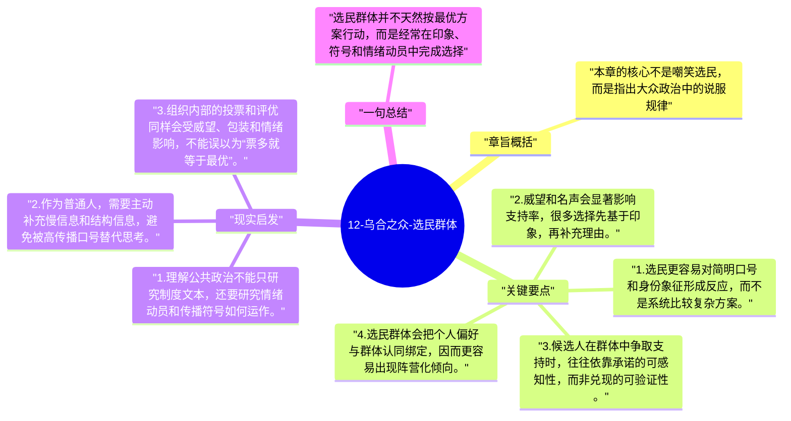

# 12-乌合之众-选民群体

这一章把前面的理论直接带入政治场景。勒庞认为，选民群体并不是通过细致比较方案来决定支持对象，而更容易受形象、口号、承诺和群体气氛影响。

## 章旨概括

本章的核心不是嘲笑选民，而是指出大众政治中的说服规律。候选人的威望、符号化形象和简单承诺，往往比深度政策设计更容易获得传播与支持。勒庞由此强调，选举并不天然等于理性筛选，它常常是群体心理、传播技术和利益动员共同作用的结果。

## 关键要点

1. 选民更容易对简明口号和身份象征形成反应，而不是系统比较复杂方案。
2. 威望和名声会显著影响支持率，很多选择先基于印象，再补充理由。
3. 候选人在群体中争取支持时，往往依靠承诺的可感知性，而非兑现的可验证性。
4. 选民群体会把个人偏好与群体认同绑定，因而更容易出现阵营化倾向。

## 现实启发

1. 理解公共政治不能只研究制度文本，还要研究情绪动员和传播符号如何运作。
2. 作为普通人，需要主动补充慢信息和结构信息，避免被高传播口号替代思考。
3. 组织内部的投票和评优同样会受威望、包装和情绪影响，不能误以为“票多就等于最优”。

## 一句总结

选民群体并不天然按最优方案行动，而是经常在印象、符号和情绪动员中完成选择。

---

## Mermaid 思维导图

### 图1

