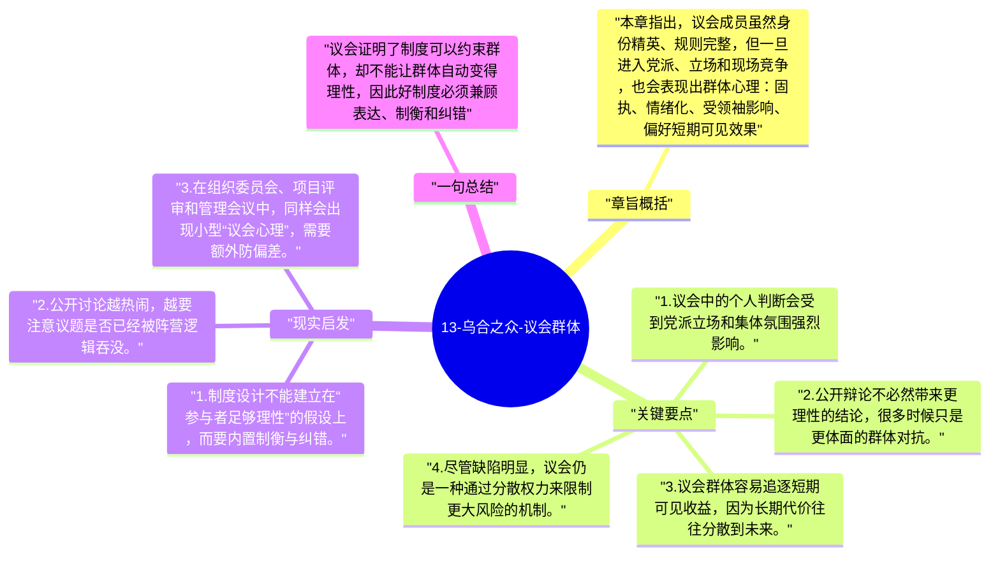

# 13-乌合之众-议会群体

全书最后一章讨论议会这种高度制度化的群体。勒庞既批评议会容易陷入派系、口号和短视，也承认它在现代政治中的现实必要性，因此这一章更像是对群体政治的收束判断。

## 章旨概括

本章指出，议会成员虽然身份精英、规则完整，但一旦进入党派、立场和现场竞争，也会表现出群体心理：固执、情绪化、受领袖影响、偏好短期可见效果。不过，议会并非毫无价值，它至少提供了公开争论、利益协调和避免单一权力失控的场域。勒庞的批评因此不是否定议会，而是提醒制度并不能消灭人性中的群体偏差。

## 关键要点

1. 议会中的个人判断会受到党派立场和集体氛围强烈影响。
2. 公开辩论不必然带来更理性的结论，很多时候只是更体面的群体对抗。
3. 议会群体容易追逐短期可见收益，因为长期代价往往分散到未来。
4. 尽管缺陷明显，议会仍是一种通过分散权力来限制更大风险的机制。

## 现实启发

1. 制度设计不能建立在“参与者足够理性”的假设上，而要内置制衡与纠错。
2. 公开讨论越热闹，越要注意议题是否已经被阵营逻辑吞没。
3. 在组织委员会、项目评审和管理会议中，同样会出现小型“议会心理”，需要额外防偏差。

## 一句总结

议会证明了制度可以约束群体，却不能让群体自动变得理性，因此好制度必须兼顾表达、制衡和纠错。

---

## Mermaid 思维导图

### 图1

