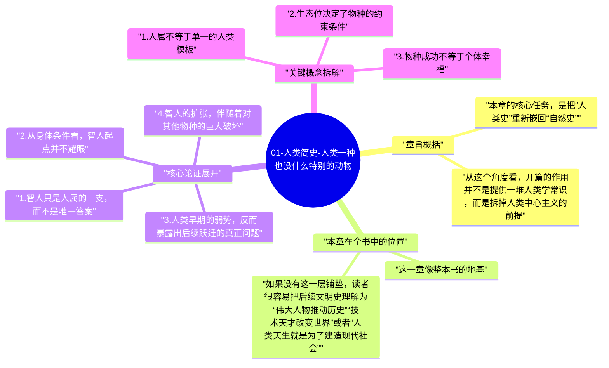
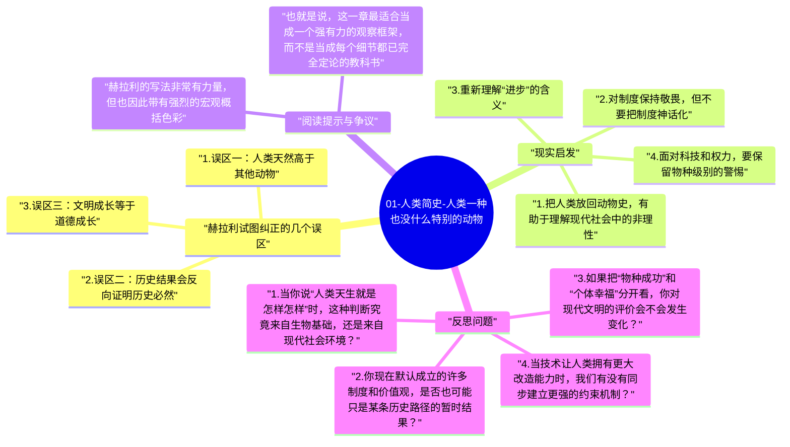
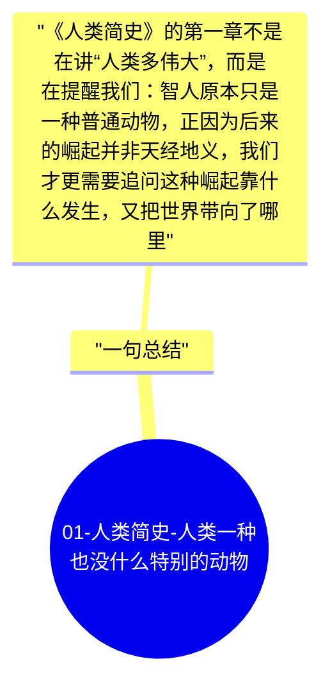

# 01-人类简史-人类一种也没什么特别的动物

《人类简史》的开篇并不急着歌颂文明、技术或制度，而是先做了一件更根本的事：把人类从“万物之灵”的高台上拉回生物演化史。赫拉利要读者先接受一个并不舒服的事实，在绝大多数时间里，智人既不高贵，也不强大，甚至谈不上特别稳定。我们只是非洲东部一个普通灵长类分支，和狮子、狼、黑猩猩一样，都受限于身体结构、环境变化和食物链秩序。

这一章的重要性在于，它替整本书校正了观察角度。只有先承认人类并非天然例外，后面关于认知革命、农业革命、帝国扩张、资本主义和科技爆发的讨论，才不会被理解成一条“人类注定伟大”的线性神话。赫拉利真正想说明的是：人类今日的支配地位不是宿命，而是历史中的偶然结果；正因为不是宿命，它才值得被追问、被拆解，也值得被怀疑。

## 章旨概括

本章的核心任务，是把“人类史”重新嵌回“自然史”。赫拉利提醒我们，智人不是地球上唯一的人类物种。数万年前，尼安德特人、直立人、弗洛勒斯人等不同人属成员曾在不同地区长期存在。今天我们习惯把“人类”视作一个自然统一的概念，但在远古时期，这个概念并没有后来这么清晰。智人最终胜出，并不意味着一开始就拥有压倒性优势。

从这个角度看，开篇的作用并不是提供一堆人类学常识，而是拆掉人类中心主义的前提。我们之所以把自己的成功解释成理所当然，是因为我们只看见幸存者，忘记了同属竞争、生态偶然与历史选择共同塑造出的路径。赫拉利要做的，恰恰是让读者从“胜利者叙事”退一步，重新看见人类原本的脆弱、普通和偶然。

## 本章在全书中的位置

这一章像整本书的地基。后面所有宏大判断，无论是关于认知革命如何让陌生人大规模合作，还是农业革命如何重组人类与作物、动物的关系，本质上都建立在一个前提上：智人首先是一种动物，而且是一种会被环境、身体条件、群体结构和生存压力塑造的动物。

如果没有这一层铺垫，读者很容易把后续文明史理解为“伟大人物推动历史”“技术天才改变世界”或者“人类天生就是为了建造现代社会”。赫拉利的野心更大，他不是想写一部英雄史，也不是写一部国家史，而是要写一部物种如何改变地球的历史。开篇先缩小人类，后面才能真正放大人类。

## 核心论证展开

### 1. 智人只是人属的一支，而不是唯一答案

现代人太容易把“人类”理解为一个单数概念，但在很长时间里，地球上存在过不止一种人类。尼安德特人生活在欧洲和西亚，直立人更早离开非洲并在欧亚大陆长期延续，弗洛勒斯人则显示出人属演化的多样性与复杂性。换句话说，智人并不是一个天然独占的物种，而是众多尝试中的一种。

这个事实的思想冲击很大。它说明“成为今天的我们”并不是唯一可能的结果。如果历史稍有不同，今天统治地球的也许不是智人，甚至未必会出现与现代文明相似的结构。赫拉利在这里故意打断那种“人类历史必然通向今天”的叙事冲动，因为一旦意识到过去存在多种可能性，读者才会更认真地看待后面的关键转折。

### 2. 从身体条件看，智人起点并不耀眼

如果只比单项能力，智人几乎没有明显优势。我们没有豹子的速度，没有熊的蛮力，没有鹰的视野，也没有狼群那样成熟而稳定的狩猎体系。在野外生存上，智人甚至一度长期处于生态链中间偏下的位置，需要小心掠食者，也需要和其他大型动物争夺资源。

这一点之所以重要，是因为它迫使我们承认：后来文明所表现出的强势，不能简单从生理天赋推导出来。人类的统治地位不是靠牙齿、爪子和肌肉直接赢来的，而是靠后续某种更不直接、却更可怕的能力建立起来的。赫拉利在本章没有把答案完全展开，但已经埋下伏笔：真正决定差距的，也许从来不是个体体能，而是组织能力、认知能力和群体协作能力。

### 3. 人类早期的弱势，反而暴露出后续跃迁的真正问题

如果智人原本并不强，问题就变成了：后来究竟发生了什么，才让这个普通物种能迅速改写生态秩序？赫拉利并没有在第一章就直接给出完整答案，但他把问题框得很清楚。真正值得解释的，不是“人类为什么会强”，而是“为什么一个原本并不强的物种能突然取得极端优势”。

这种提问方式非常关键。它把注意力从“结果崇拜”转向“机制分析”。很多历史叙事习惯直接从今天的结果倒推过去的合理性，于是会自然地把智人的胜利描述成能力压制。赫拉利不这么做，他更在意的是从弱势到强势之间发生的机制变化，这也为后文的认知革命铺平了道路。

### 4. 智人的扩张，伴随着对其他物种的巨大破坏

赫拉利开篇就埋下另一个重要判断：人类的崛起并不只是“文明进步”的故事，也是生态破坏的故事。智人每到一个新大陆，往往都会伴随大型动物灭绝、生态位重组和原有平衡被打破。也就是说，从物种史角度看，人类并不只是建设者，同时也是极高效率的破坏者。

这层判断会让整本书的基调发生变化。它提醒我们，不要把人类能力简单等同于道德进步。一个物种更强，并不意味着它更善良、更高尚或更配得上统治。智人之所以可怕，不在于它天然文明，而在于它拥有越来越强的改造环境能力，却未必同步增长足够的自我约束能力。

### 5. 人类中心主义是一种后见之明偏差

我们习惯从现代结果出发，自动赋予人类一种宿命般的特殊地位。宗教叙事、民族叙事、文明叙事，甚至很多通俗科学写作，都会或多或少地暗示“人类注定走到今天”。赫拉利开篇的价值，正是反过来削弱这种后见之明偏差。既然智人曾经只是普通动物，那么后来的一切都不是当然发生的。

一旦接受这一点，历史阅读的姿态会变得谦卑很多。你不会再轻易把今天的秩序当作必然，更不会把任何既有制度视作自然延伸。历史不是为了证明“我们现在这样最好”，而是为了提醒我们：今天的一切也可能只是暂时站稳的某条路径。

## 关键概念拆解

### 1. 人属不等于单一的人类模板

很多人第一次接触远古史时，会把“人属”理解为一条直线：从原始到高级、从低等到高等，最后自然发展到智人。赫拉利要纠正的恰恰是这种过度简化。人属更像一棵分叉很多的树，而不是只有一根主干的楼梯。不同人种在不同地区演化、适应和竞争，历史结果并不是预先写好的。

### 2. 生态位决定了物种的约束条件

物种不是在抽象空间里生存，而是在具体生态位中竞争资源、躲避危险并形成行为模式。把智人放回生态位中观察，就会发现很多后来被我们当作“文明选择”的事情，最初都带着强烈的生存压力痕迹。赫拉利通过这种视角提醒我们，制度和文化再复杂，也没有彻底摆脱生物基础。

### 3. 物种成功不等于个体幸福

这是《人类简史》后面反复出现的主题，在本章已经露出端倪。一个物种在人口规模、地理扩张和生态支配上获得成功，不代表其成员生活得更轻松、更幸福或更有尊严。后来农业革命会进一步证明，物种层面的胜利与个体层面的处境，常常并不是一回事。

## 赫拉利试图纠正的几个误区

### 1. 误区一：人类天然高于其他动物

赫拉利并不否认人类的独特性，但他反对把这种独特性神圣化。人类当然具有极强的认知和协作能力，但这不意味着我们可以脱离动物史被理解。越早放弃那种“人类天然高贵”的预设，越能看清自身行为中的竞争性、侵略性和群体性。

### 2. 误区二：历史结果会反向证明历史必然

人类今天占据主导地位，并不能证明这种结果一开始就注定如此。很多历史路径之所以看起来合理，只是因为失败选项已经被淘汰得看不见了。赫拉利通过列出其他人种的存在，实际上是在提醒读者对“必然性叙事”保持警惕。

### 3. 误区三：文明成长等于道德成长

一个物种能够建立帝国、发展科技和重塑地球，不表示它更善良。人类能力的扩大和道德自觉的扩大，从来不是自动同步的。正因为我们有巨大的改造能力，才更需要警惕这种能力被拿来合理化控制、剥削和毁灭。

## 现实启发

### 1. 把人类放回动物史，有助于理解现代社会中的非理性

现代人经常以为自己主要是理性行动者，但现实生活中的嫉妒、竞争、部落归属、权力欲和模仿冲动，仍然带着深厚的生物与群体基础。如果脱离这一点去理解政治、商业和舆论，就会把很多集体行为看得过于理想化。承认人类仍然保留强烈动物性，不是悲观，而是更接近事实。

### 2. 对制度保持敬畏，但不要把制度神话化

既然人类的强大并非天然，而是建立在后续协作机制上，那么制度确实重要。问题在于，制度再强，也只是人类为组织合作而设计出的临时结构，而不是超越历史的真理。理解这一点后，我们既不会轻率否认制度价值，也不会把任何制度误认为永恒正确。

### 3. 重新理解“进步”的含义

现代社会习惯把更高产、更高效、更能扩张等同于进步，但赫拉利的写法提醒我们，进步至少应该同时回答两个问题：它让群体更强了吗？它让个体活得更好吗？如果只有前者，没有后者，那么所谓进步就可能只是从物种竞争角度成立，而不一定从人的生活质量角度成立。

### 4. 面对科技和权力，要保留物种级别的警惕

人类从远古到现代始终在放大自身能力，今天这种放大已经从火、农业、帝国和资本，走到了 AI、基因编辑和全球平台系统。第一章看似只是在讲远古史，实际上已经提供了一个极其现代的提醒：当一个并不天然高尚的物种不断增强力量时，真正的问题不只是“能不能做到”，而是“做得到之后会怎样”。

## 阅读提示与争议

赫拉利的写法非常有力量，但也因此带有强烈的宏观概括色彩。阅读这一章时，需要同时保持两种态度。第一种是接受它作为“认知校正”的价值，它确实能有效打破人类中心主义。第二种是保留对细节证据的敏感，因为关于远古人种竞争、灭绝原因、智人与其他人种关系的具体学术问题，学界并非没有争议。

也就是说，这一章最适合当成一个强有力的观察框架，而不是当成每个细节都已完全定论的教科书。它的价值不在于替代专业人类学文献，而在于帮普通读者快速建立一双更有尺度感的眼睛。

## 反思问题

1. 当你说“人类天生就是怎样怎样”时，这种判断究竟来自生物基础，还是来自现代社会环境？
2. 你现在默认成立的许多制度和价值观，是否也可能只是某条历史路径的暂时结果？
3. 如果把“物种成功”和“个体幸福”分开看，你对现代文明的评价会不会发生变化？
4. 当技术让人类拥有更大改造能力时，我们有没有同步建立更强的约束机制？

## 一句总结

《人类简史》的第一章不是在讲“人类多伟大”，而是在提醒我们：智人原本只是一种普通动物，正因为后来的崛起并非天经地义，我们才更需要追问这种崛起靠什么发生，又把世界带向了哪里。

---

## Mermaid 思维导图

### 图1

### 图2

### 图3

