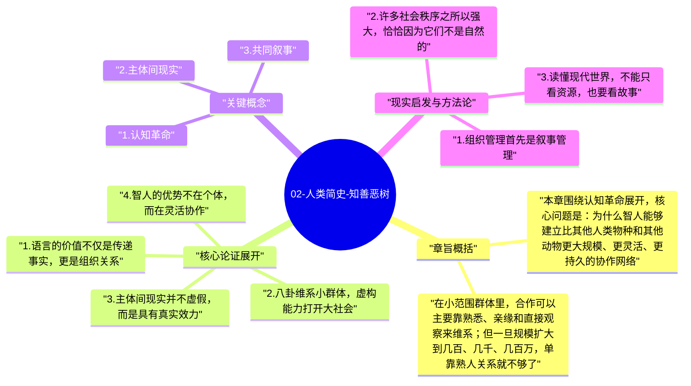
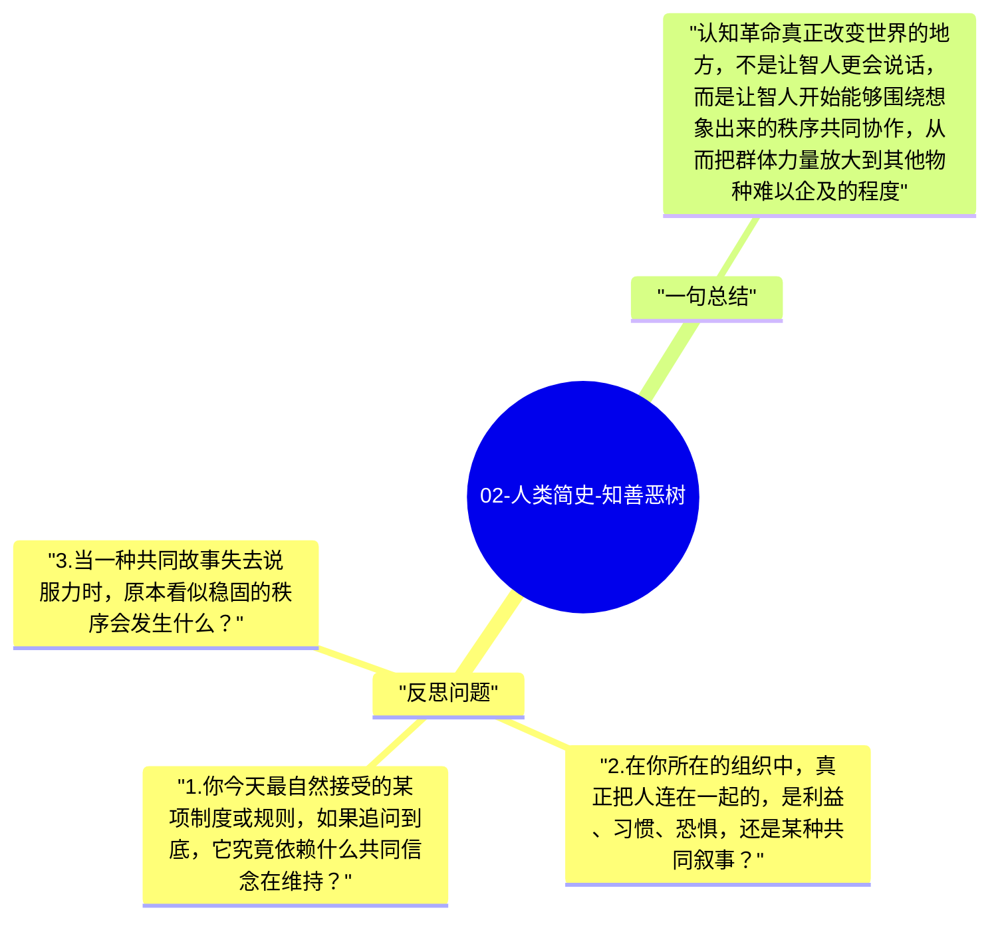

# 02-人类简史-知善恶树

如果说第一章的任务，是把人类从自我神话中拉下来，那么这一章的任务，就是解释这个普通物种后来究竟凭什么改写世界。赫拉利给出的答案非常大胆：智人真正的飞跃，不是发生在肌肉、牙齿或工具层面，而是发生在认知层面。我们开始能够谈论并不存在于眼前场景中的事物，开始能够围绕神话、规则、身份、法律和价值观达成共同理解，这种能力让人类社会第一次突破了小规模熟人群体的边界。

这也是《人类简史》全书最重要的转折点之一。因为从这一章开始，后面关于国家、宗教、金钱、企业、帝国和资本主义的讨论，才有了共同基础。赫拉利真正要说明的不是“人类会说话”，而是“人类会共同相信虚构之物，并据此组织现实行动”。这一步一旦成立，智人的优势就不再只是个体聪明，而是群体协作能力的指数级放大。

## 章旨概括

本章围绕认知革命展开，核心问题是：为什么智人能够建立比其他人类物种和其他动物更大规模、更灵活、更持久的协作网络。赫拉利的回答是，语言不仅让人交换信息，也让人创造主体间现实。所谓主体间现实，不是物理世界中天然存在的东西，而是靠很多人共同相信、共同维护才成立的秩序，例如部落图腾、神祇、法律、货币、公司、国家和人权。

在小范围群体里，合作可以主要靠熟悉、亲缘和直接观察来维系；但一旦规模扩大到几百、几千、几百万，单靠熟人关系就不够了。智人的突破正在于：我们可以让大量彼此陌生的人，因为共同相信同一个故事，而愿意遵守同一套规则。这种能力，本质上才是现代文明的心理基础设施。

## 核心论证展开

### 1. 语言的价值不仅是传递事实，更是组织关系

传统理解里，语言像是一种更高效的交流工具，帮助人传递“这里有狮子”“那边有果子”之类的现实信息。赫拉利认为，这种理解太浅了。语言之所以让智人真正脱颖而出，不是因为它比其他动物的信号系统更复杂一点，而是因为它能传递抽象、想象和不在场的信息。

更具体地说，语言让人能够谈论过去、未来、未发生之事，也能谈论没有物理实体却具有社会效力的对象。例如某个祖先神灵、某套禁忌、某种部落身份、某项交易规则。这意味着，语言不再只是沟通工具，而开始成为组织现实的工具。它帮助人类不只分享经验，更分享世界观。

### 2. 八卦维系小群体，虚构能力打开大社会

赫拉利没有把人类语言浪漫化成纯理性工具，他甚至强调“八卦”是语言早期非常重要的功能。八卦帮助小群体成员了解谁可信、谁偷懒、谁结盟、谁违背规范，从而让群体内部的合作和惩罚更有效。这个观察很关键，因为它说明人类协作并不是建立在纯高尚动机上，而是建立在对关系网络的持续更新上。

但八卦只能维持规模有限的熟人群体。真正让社会突破邓巴数上限的，是虚构能力。只要足够多人相信“我们属于同一个民族”“这家公司是有法律人格的实体”“这张纸代表价值”“这部经典拥有神圣权威”，合作的半径就会被大幅拉长。也就是说，现代大社会并不是靠天然感情维系，而是靠抽象叙事维系。

### 3. 主体间现实并不虚假，而是具有真实效力

很多人一听到“虚构”“想象”，会以为赫拉利在说这些秩序都是假的、毫无力量的。但他真正想表达的是：这些秩序并不属于客观自然界，却依然能够在现实中产生极强约束力。公司不是石头或树木那样的客观实体，但它可以雇人、签合同、欠债、纳税；国家不是自然长出来的东西，但它能征兵、收税、立法；货币本身可能只是纸或数字，但它确实能调动资源和组织分工。

这正是主体间现实最厉害也最危险的地方。它既脆弱，因为一旦大范围失去信任就可能崩塌；又强大，因为只要足够多人继续相信，它就拥有改变现实的能力。赫拉利通过这个概念，实际上把后面整个文明史的底层逻辑提前埋好了。

### 4. 智人的优势不在个体，而在灵活协作

这一章最有颠覆性的地方，可能在于它重新定义了“聪明”。很多人会本能地把智人的胜出理解成单个个体脑力更强，但赫拉利更强调的是群体层面的组织弹性。蜜蜂、蚂蚁也能协作，但它们的合作方式高度固定，难以快速切换规则；黑猩猩有一定社会性，但合作规模有限。智人的独特性在于，可以迅速根据新叙事、新规则、新环境重组合作网络。

这意味着，智人的统治地位不是某个天赋点数特别高，而是可以不断重写“我们为什么在一起”“我们为什么要这样做”。正因为能共同编织和更新故事，智人才具有极强的制度创新与扩张能力。

## 关键概念

### 1. 认知革命

认知革命不是某一件单独事件，而是人类心智能力发生结构变化的阶段。它让语言从现实描述升级为抽象组织工具，为后续一切复杂制度奠定心理前提。

### 2. 主体间现实

主体间现实指那些不属于纯客观自然界，也不只是某个人脑内幻觉，而是靠多人共同相信才成立的秩序。法律、货币、宗教、企业和国家都可归入此类。

### 3. 共同叙事

共同叙事是主体间现实得以维系的具体载体。它可以是神话、民族故事、公司使命、制度合法性，也可以是市场对于价值的某种集体相信。叙事越稳定，协作越容易维持。

## 现实启发与方法论

### 1. 组织管理首先是叙事管理

一个团队能否长久协作，很多时候不只取决于利益分配，也取决于成员是否共享同一套意义框架。目标、愿景、规则和身份感，本质上都是组织叙事的一部分。没有共同叙事，利益一变，协作就很容易解体。

### 2. 许多社会秩序之所以强大，恰恰因为它们不是自然的

一旦意识到制度、法律、货币和企业都属于主体间现实，我们对它们的理解就会更准确。它们不是天经地义，也不是纯幻想，而是被历史不断维护和更新的协作协议。理解这一点后，人既不会轻率神话制度，也不会轻率否认制度。

### 3. 读懂现代世界，不能只看资源，也要看故事

政治、商业、宗教、民族认同、品牌忠诚，很多表面上看是利益问题，底层却总有叙事问题。谁能塑造稳定可信的故事，谁就更容易组织他人行动。

## 反思问题

1. 你今天最自然接受的某项制度或规则，如果追问到底，它究竟依赖什么共同信念在维持？
2. 在你所在的组织中，真正把人连在一起的，是利益、习惯、恐惧，还是某种共同叙事？
3. 当一种共同故事失去说服力时，原本看似稳固的秩序会发生什么？

## 一句总结

认知革命真正改变世界的地方，不是让智人更会说话，而是让智人开始能够围绕想象出来的秩序共同协作，从而把群体力量放大到其他物种难以企及的程度。

---

## Mermaid 思维导图

### 图1

### 图2

