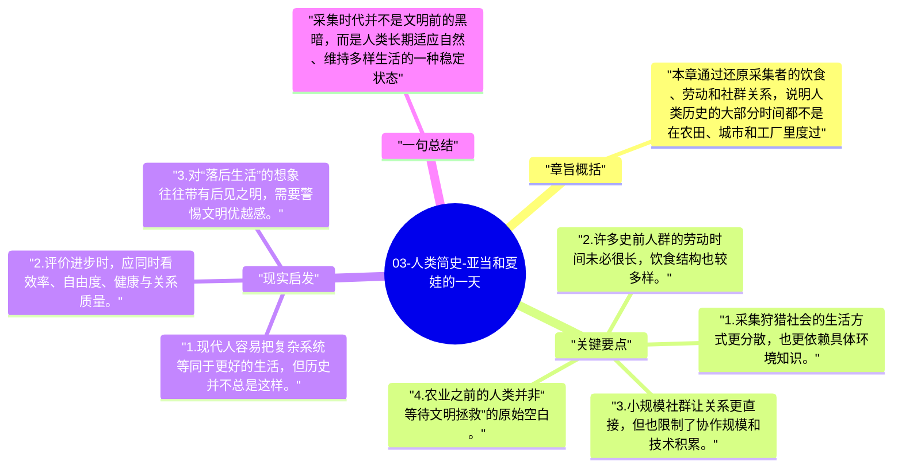

# 03-人类简史-亚当和夏娃的一天

这一章把镜头拉近到采集狩猎时代的日常生活，纠正“史前人类一定粗糙、贫困、痛苦”的单向想象。赫拉利认为，早期采集者的生活并不必然比农业社会更差。

## 章旨概括

本章通过还原采集者的饮食、劳动和社群关系，说明人类历史的大部分时间都不是在农田、城市和工厂里度过。采集者的知识结构高度依赖环境观察，劳动时间未必比后世更长，饮食也可能更丰富。赫拉利借此反问：文明的推进是否真的自动等于个人生活质量的提升。

## 关键要点

1. 采集狩猎社会的生活方式更分散，也更依赖具体环境知识。
2. 许多史前人群的劳动时间未必很长，饮食结构也较多样。
3. 小规模社群让关系更直接，但也限制了协作规模和技术积累。
4. 农业之前的人类并非“等待文明拯救”的原始空白。

## 现实启发

1. 现代人容易把复杂系统等同于更好的生活，但历史并不总是这样。
2. 评价进步时，应同时看效率、自由度、健康与关系质量。
3. 对“落后生活”的想象往往带有后见之明，需要警惕文明优越感。

## 一句总结

采集时代并不是文明前的黑暗，而是人类长期适应自然、维持多样生活的一种稳定状态。

---

## Mermaid 思维导图

### 图1

