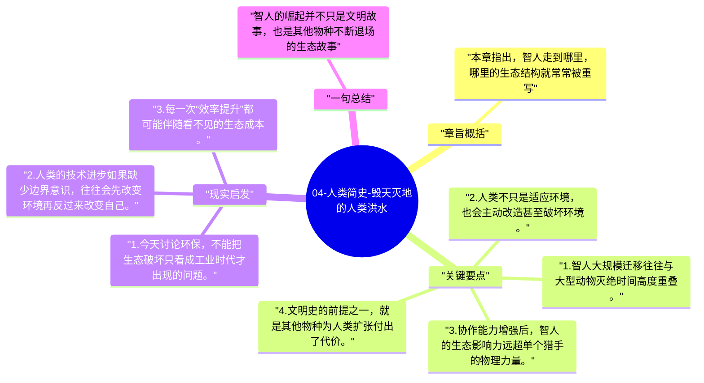

# 04-人类简史-毁天灭地的人类洪水

第四章把认知革命的另一面摆出来：智人扩张几乎总伴随着其他大型动物的消失。赫拉利借此说明，人类很早就是生态意义上的强干预者。

## 章旨概括

本章指出，智人走到哪里，哪里的生态结构就常常被重写。美洲、澳洲等地大型动物的灭绝，并不只与气候变化有关，也与智人的狩猎、扩张和环境重塑密切相关。认知革命带来的协作能力，让人类第一次能够系统性地改变整个生态圈。

## 关键要点

1. 智人大规模迁移往往与大型动物灭绝时间高度重叠。
2. 人类不只是适应环境，也会主动改造甚至破坏环境。
3. 协作能力增强后，智人的生态影响力远超单个猎手的物理力量。
4. 文明史的前提之一，就是其他物种为人类扩张付出了代价。

## 现实启发

1. 今天讨论环保，不能把生态破坏只看成工业时代才出现的问题。
2. 人类的技术进步如果缺少边界意识，往往会先改变环境再反过来改变自己。
3. 每一次“效率提升”都可能伴随看不见的生态成本。

## 一句总结

智人的崛起并不只是文明故事，也是其他物种不断退场的生态故事。

---

## Mermaid 思维导图

### 图1

