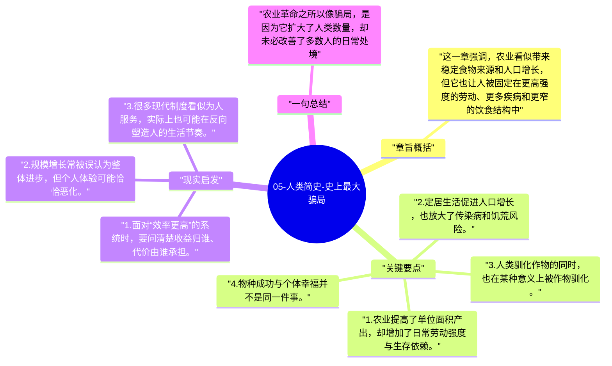

# 05-人类简史-史上最大骗局

进入农业革命后，赫拉利提出全书最出名的判断之一：农业并不一定让个体过得更好，反而可能让多数人的生活更辛苦、更单调、更脆弱。

## 章旨概括

这一章强调，农业看似带来稳定食物来源和人口增长，但它也让人被固定在更高强度的劳动、更多疾病和更窄的饮食结构中。真正获益的并不一定是个体幸福，而是小麦、稻米等作物以及依附其上的人口扩张。赫拉利因此称农业革命为“骗局”，因为它以物种规模胜利换取了个人生活质量下降。

## 关键要点

1. 农业提高了单位面积产出，却增加了日常劳动强度与生存依赖。
2. 定居生活促进人口增长，也放大了传染病和饥荒风险。
3. 人类驯化作物的同时，也在某种意义上被作物驯化。
4. 物种成功与个体幸福并不是同一件事。

## 现实启发

1. 面对“效率更高”的系统时，要问清楚收益归谁、代价由谁承担。
2. 规模增长常被误认为整体进步，但个人体验可能恰恰恶化。
3. 很多现代制度看似为人服务，实际上也可能在反向塑造人的生活节奏。

## 一句总结

农业革命之所以像骗局，是因为它扩大了人类数量，却未必改善了多数人的日常处境。

---

## Mermaid 思维导图

### 图1

