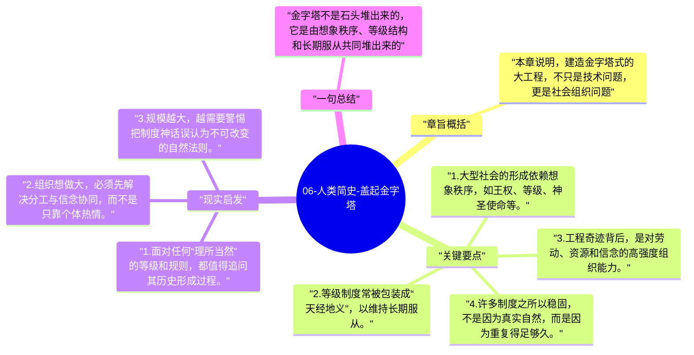

# 06-人类简史-盖起金字塔

农业剩余让更大规模的协作成为可能，但协作本身需要秩序和分工。于是，等级、官僚和想象秩序开始成为大型社会运转的底层装置。

## 章旨概括

本章说明，建造金字塔式的大工程，不只是技术问题，更是社会组织问题。农业社会通过等级划分、税收征集、集体神话和服从训练，把大量陌生人组织到同一套秩序里。赫拉利强调，这些等级制度往往不是自然真理，而是被反复讲述、被法律和习俗固化的想象秩序。

## 关键要点

1. 大型社会的形成依赖想象秩序，如王权、等级、神圣使命等。
2. 等级制度常被包装成“天经地义”，以维持长期服从。
3. 工程奇迹背后，是对劳动、资源和信念的高强度组织能力。
4. 许多制度之所以稳固，不是因为真实自然，而是因为重复得足够久。

## 现实启发

1. 面对任何“理所当然”的等级和规则，都值得追问其历史形成过程。
2. 组织想做大，必须先解决分工与信念协同，而不是只靠个体热情。
3. 规模越大，越需要警惕把制度神话误认为不可改变的自然法则。

## 一句总结

金字塔不是石头堆出来的，它是由想象秩序、等级结构和长期服从共同堆出来的。

---

## Mermaid 思维导图

### 图1

