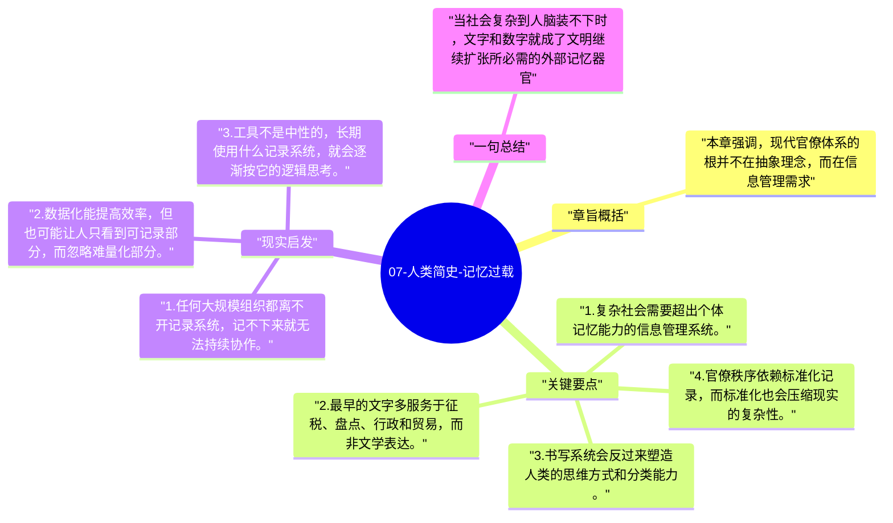

# 07-人类简史-记忆过载

随着农业社会越来越复杂，单靠人脑已经无法管理税收、土地、贸易和人口。于是，书写、数字和档案系统开始出现，文明进入“外部记忆”时代。

## 章旨概括

本章强调，现代官僚体系的根并不在抽象理念，而在信息管理需求。苏美尔人的泥板记录、早期数字系统和分类方式，让复杂社会得以长期运转。赫拉利由此说明，文字不是单纯的文学工具，它首先是一套让社会记忆脱离个体大脑的管理技术。

## 关键要点

1. 复杂社会需要超出个体记忆能力的信息管理系统。
2. 最早的文字多服务于征税、盘点、行政和贸易，而非文学表达。
3. 书写系统会反过来塑造人类的思维方式和分类能力。
4. 官僚秩序依赖标准化记录，而标准化也会压缩现实的复杂性。

## 现实启发

1. 任何大规模组织都离不开记录系统，记不下来就无法持续协作。
2. 数据化能提高效率，但也可能让人只看到可记录部分，而忽略难量化部分。
3. 工具不是中性的，长期使用什么记录系统，就会逐渐按它的逻辑思考。

## 一句总结

当社会复杂到人脑装不下时，文字和数字就成了文明继续扩张所必需的外部记忆器官。

---

## Mermaid 思维导图

### 图1

