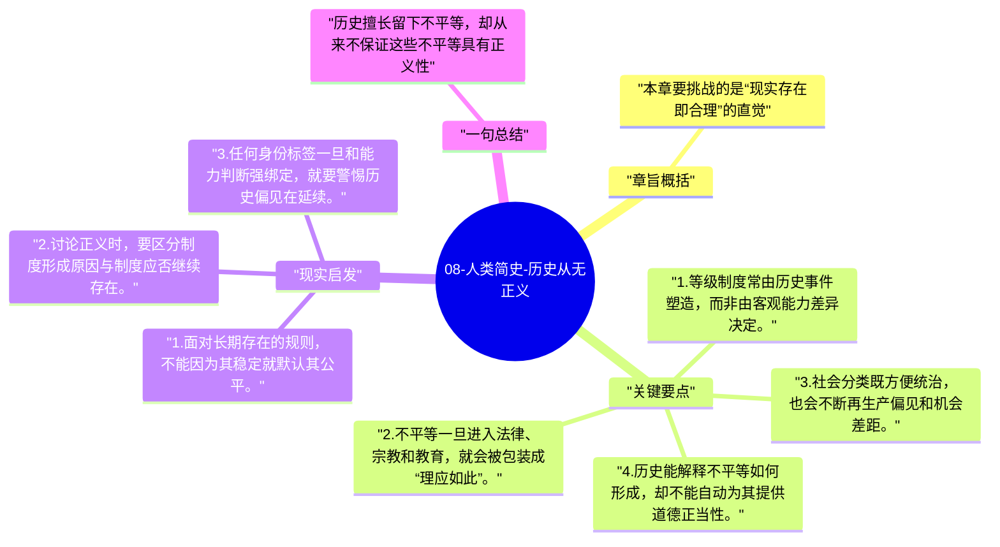

# 08-人类简史-历史从无正义

这一章集中讨论等级制度的任意性。赫拉利直言，历史形成的种族、性别和阶级结构，并不因为存在得久就更合理，它们往往只是权力关系被神圣化后的结果。

## 章旨概括

本章要挑战的是“现实存在即合理”的直觉。社会不平等常常源于历史偶然、暴力征服和制度固化，之后再被编织成自然差异。赫拉利通过阶级、种族与性别案例说明，所谓正义秩序并不是历史演化的默认产物，相反，历史更常把有利于强者的安排留下来。

## 关键要点

1. 等级制度常由历史事件塑造，而非由客观能力差异决定。
2. 不平等一旦进入法律、宗教和教育，就会被包装成“理应如此”。
3. 社会分类既方便统治，也会不断再生产偏见和机会差距。
4. 历史能解释不平等如何形成，却不能自动为其提供道德正当性。

## 现实启发

1. 面对长期存在的规则，不能因为其稳定就默认其公平。
2. 讨论正义时，要区分制度形成原因与制度应否继续存在。
3. 任何身份标签一旦和能力判断强绑定，就要警惕历史偏见在延续。

## 一句总结

历史擅长留下不平等，却从来不保证这些不平等具有正义性。

---

## Mermaid 思维导图

### 图1

