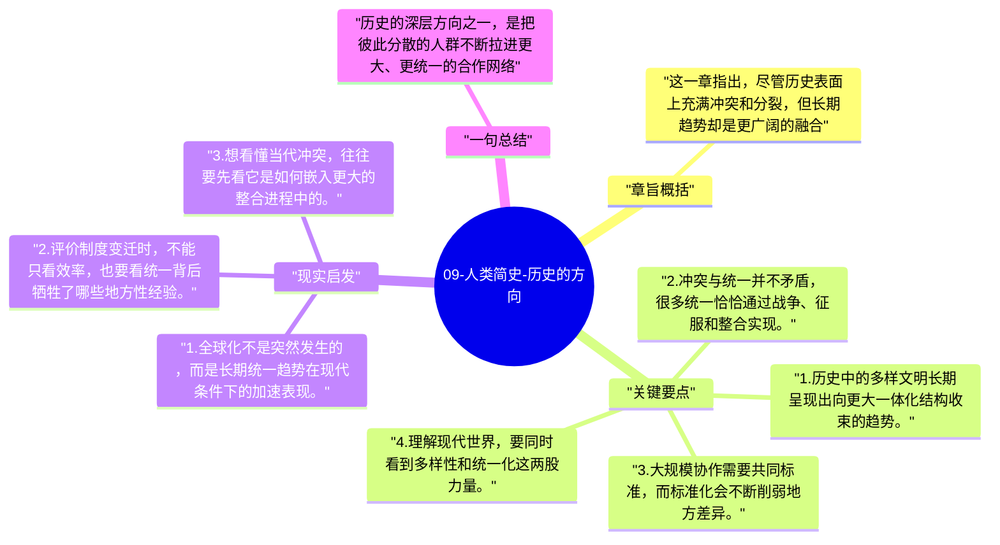

# 09-人类简史-历史的方向

到了第三部分，赫拉利开始回答一个更大的问题：人类历史为什么越走越“统一”。不同文化、帝国、货币和宗教最终似乎都在走向更大范围的整合。

## 章旨概括

这一章指出，尽管历史表面上充满冲突和分裂，但长期趋势却是更广阔的融合。地方社群被更大的政治、经济和文化网络吸纳，人类越来越生活在共享规则和共享想象里。赫拉利并不把这看成单纯进步，而是把它视为历史最显著的方向之一。

## 关键要点

1. 历史中的多样文明长期呈现出向更大一体化结构收束的趋势。
2. 冲突与统一并不矛盾，很多统一恰恰通过战争、征服和整合实现。
3. 大规模协作需要共同标准，而标准化会不断削弱地方差异。
4. 理解现代世界，要同时看到多样性和统一化这两股力量。

## 现实启发

1. 全球化不是突然发生的，而是长期统一趋势在现代条件下的加速表现。
2. 评价制度变迁时，不能只看效率，也要看统一背后牺牲了哪些地方性经验。
3. 想看懂当代冲突，往往要先看它是如何嵌入更大的整合进程中的。

## 一句总结

历史的深层方向之一，是把彼此分散的人群不断拉进更大、更统一的合作网络。

---

## Mermaid 思维导图

### 图1

