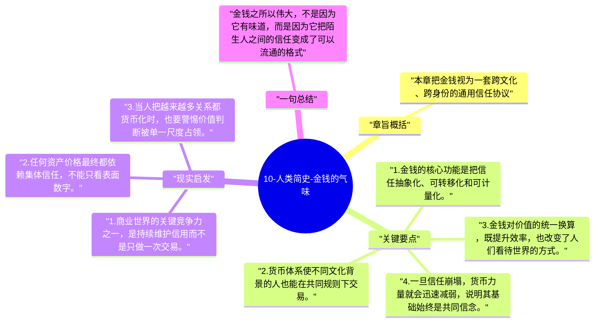

# 10-人类简史-金钱的气味

这一章说明，金钱之所以强大，不在于它本身有多少物理价值，而在于它能让陌生人之间快速建立交换信任。某种意义上，金钱是历史上最成功的共同神话之一。

## 章旨概括

本章把金钱视为一套跨文化、跨身份的通用信任协议。人们愿意接受货币，不是因为纸或金属本身，而是因为相信别人也会接受。相比宗教和帝国，金钱对身份差异更不敏感，因此能在更大范围内促进合作。赫拉利借此说明，现代世界的统一并不只靠武力，也靠交易与信用。

## 关键要点

1. 金钱的核心功能是把信任抽象化、可转移化和可计量化。
2. 货币体系使不同文化背景的人也能在共同规则下交易。
3. 金钱对价值的统一换算，既提升效率，也改变了人们看待世界的方式。
4. 一旦信任崩塌，货币力量就会迅速减弱，说明其基础始终是共同信念。

## 现实启发

1. 商业世界的关键竞争力之一，是持续维护信用而不是只做一次交易。
2. 任何资产价格最终都依赖集体信任，不能只看表面数字。
3. 当人把越来越多关系都货币化时，也要警惕价值判断被单一尺度占领。

## 一句总结

金钱之所以伟大，不是因为它有味道，而是因为它把陌生人之间的信任变成了可以流通的格式。

---

## Mermaid 思维导图

### 图1

