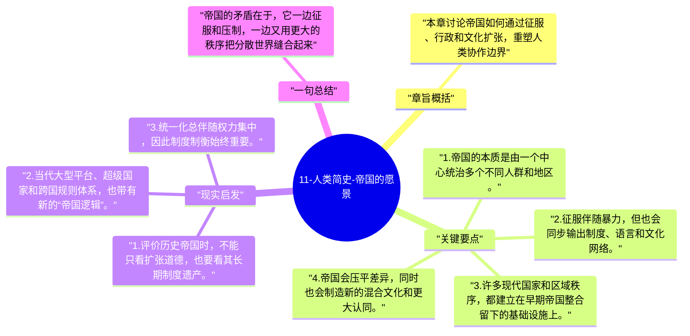

# 11-人类简史-帝国的愿景

在赫拉利这里，帝国不是简单的暴政符号，而是一种把大量不同民族、语言和习俗纳入同一秩序的历史装置。它粗暴，却也确实推动了统一。

## 章旨概括

本章讨论帝国如何通过征服、行政和文化扩张，重塑人类协作边界。帝国常常伴随压迫和剥夺，但它也会带来法律、语言、道路、税制和知识传播的统一框架。赫拉利的重点不是为帝国辩护，而是说明现代世界的形成离不开这些大规模整合机器。

## 关键要点

1. 帝国的本质是由一个中心统治多个不同人群和地区。
2. 征服伴随暴力，但也会同步输出制度、语言和文化网络。
3. 许多现代国家和区域秩序，都建立在早期帝国整合留下的基础设施上。
4. 帝国会压平差异，同时也会制造新的混合文化和更大认同。

## 现实启发

1. 评价历史帝国时，不能只看扩张道德，也要看其长期制度遗产。
2. 当代大型平台、超级国家和跨国规则体系，也带有新的“帝国逻辑”。
3. 统一化总伴随权力集中，因此制度制衡始终重要。

## 一句总结

帝国的矛盾在于，它一边征服和压制，一边又用更大的秩序把分散世界缝合起来。

---

## Mermaid 思维导图

### 图1

