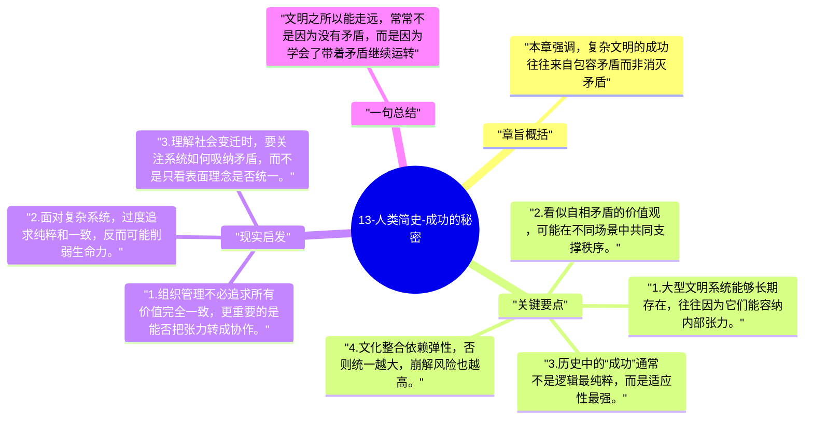

# 13-人类简史-成功的秘密

这一章承接前面关于统一的讨论，进一步指出人类社会之所以能不断扩张，不是因为找到了一套最终正确的秩序，而是因为它能在矛盾中持续调整、吸收和重组。

## 章旨概括

本章强调，复杂文明的成功往往来自包容矛盾而非消灭矛盾。帝国、宗教、市场和国家内部经常存在彼此冲突的价值，但只要这些张力还能被组织起来，系统就能继续扩张。赫拉利借此提醒，历史并不是朝单一真理线性前进，而更像不断重组的合作实验。

## 关键要点

1. 大型文明系统能够长期存在，往往因为它们能容纳内部张力。
2. 看似自相矛盾的价值观，可能在不同场景中共同支撑秩序。
3. 历史中的“成功”通常不是逻辑最纯粹，而是适应性最强。
4. 文化整合依赖弹性，否则统一越大，崩解风险也越高。

## 现实启发

1. 组织管理不必追求所有价值完全一致，更重要的是能否把张力转成协作。
2. 面对复杂系统，过度追求纯粹和一致，反而可能削弱生命力。
3. 理解社会变迁时，要关注系统如何吸纳矛盾，而不是只看表面理念是否统一。

## 一句总结

文明之所以能走远，常常不是因为没有矛盾，而是因为学会了带着矛盾继续运转。

---

## Mermaid 思维导图

### 图1

