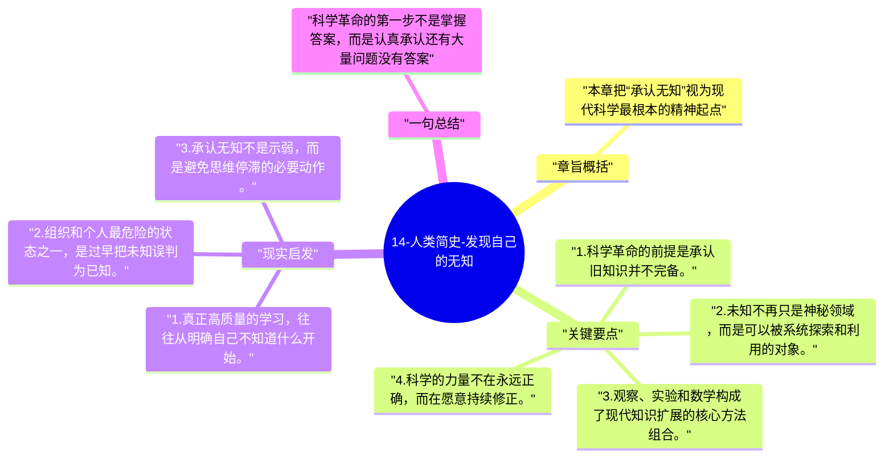

# 14-人类简史-发现自己的无知

到了科学革命，赫拉利把一个关键转折挑了出来：现代科学并不是因为“知道更多”而开始，而是因为承认自己还有大量不知道的东西。

## 章旨概括

本章把“承认无知”视为现代科学最根本的精神起点。前现代文明也有知识体系，但往往认为关键答案已经掌握；科学革命则反过来，把未知当成探索入口，再通过观察、实验和数学方法持续修正。正是这种制度化的求知姿态，让近代世界的知识增长速度陡然改变。

## 关键要点

1. 科学革命的前提是承认旧知识并不完备。
2. 未知不再只是神秘领域，而是可以被系统探索和利用的对象。
3. 观察、实验和数学构成了现代知识扩展的核心方法组合。
4. 科学的力量不在永远正确，而在愿意持续修正。

## 现实启发

1. 真正高质量的学习，往往从明确自己不知道什么开始。
2. 组织和个人最危险的状态之一，是过早把未知误判为已知。
3. 承认无知不是示弱，而是避免思维停滞的必要动作。

## 一句总结

科学革命的第一步不是掌握答案，而是认真承认还有大量问题没有答案。

---

## Mermaid 思维导图

### 图1

