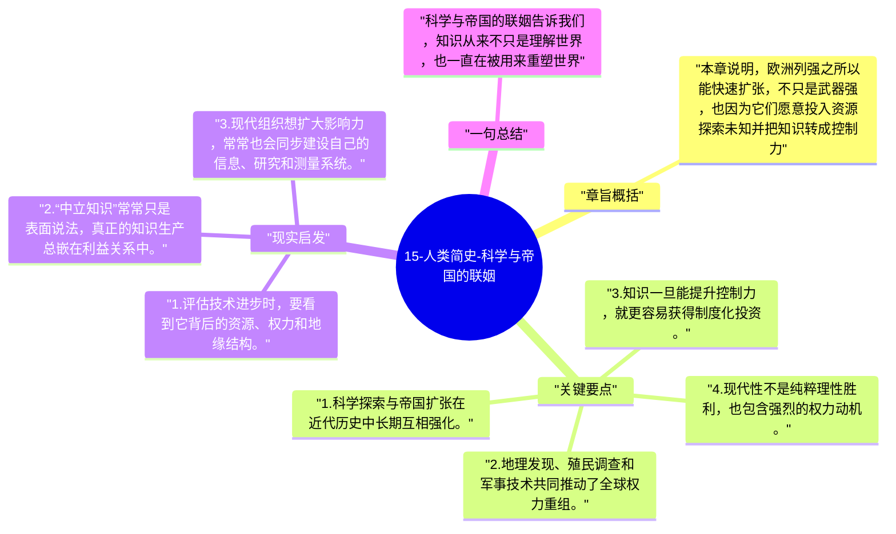

# 15-人类简史-科学与帝国的联姻

赫拉利指出，近代科学的崛起并不是实验室里独立发生的，它与帝国扩张、航海探索和全球征服深度纠缠。知识增长和权力扩张，在这里形成了强循环。

## 章旨概括

本章说明，欧洲列强之所以能快速扩张，不只是武器强，也因为它们愿意投入资源探索未知并把知识转成控制力。地图、植物学、天文学、航海技术和行政调查都服务于帝国扩张，而帝国又反过来为科学提供资金、样本和应用场景。现代世界因此是知识与权力共同推进的产物。

## 关键要点

1. 科学探索与帝国扩张在近代历史中长期互相强化。
2. 地理发现、殖民调查和军事技术共同推动了全球权力重组。
3. 知识一旦能提升控制力，就更容易获得制度化投资。
4. 现代性不是纯粹理性胜利，也包含强烈的权力动机。

## 现实启发

1. 评估技术进步时，要看到它背后的资源、权力和地缘结构。
2. “中立知识”常常只是表面说法，真正的知识生产总嵌在利益关系中。
3. 现代组织想扩大影响力，常常也会同步建设自己的信息、研究和测量系统。

## 一句总结

科学与帝国的联姻告诉我们，知识从来不只是理解世界，也一直在被用来重塑世界。

---

## Mermaid 思维导图

### 图1

