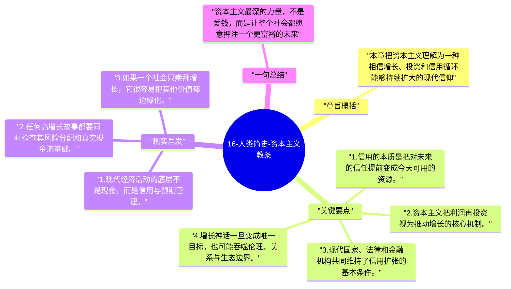

# 16-人类简史-资本主义教条

这一章解释现代资本主义为什么能成为全球主导秩序。赫拉利认为，其关键不只是逐利，而是建立在对“未来会更好”的信用信念之上。

## 章旨概括

本章把资本主义理解为一种相信增长、投资和信用循环能够持续扩大的现代信仰。银行和金融系统之所以能创造巨大杠杆，是因为社会普遍相信未来会产生更多财富。资本主义因此不是简单的贪婪，而是一套把时间、风险和期待组织成生产动力的制度结构。

## 关键要点

1. 信用的本质是把对未来的信任提前变成今天可用的资源。
2. 资本主义把利润再投资视为推动增长的核心机制。
3. 现代国家、法律和金融机构共同维持了信用扩张的基本条件。
4. 增长神话一旦变成唯一目标，也可能吞噬伦理、关系与生态边界。

## 现实启发

1. 现代经济活动的底层不是现金，而是信用与预期管理。
2. 任何高增长故事都要同时检查其风险分配和真实现金流基础。
3. 如果一个社会只崇拜增长，它很容易把其他价值都边缘化。

## 一句总结

资本主义最深的力量，不是爱钱，而是让整个社会都愿意押注一个更富裕的未来。

---

## Mermaid 思维导图

### 图1

