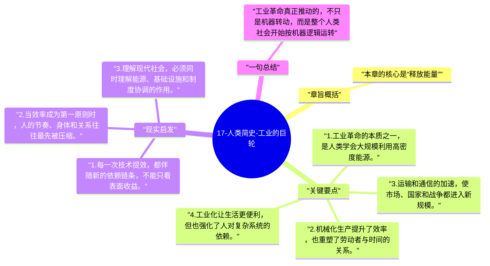

# 17-人类简史-工业的巨轮

工业革命把能量和生产力推进到前所未有的水平，也把人类生活全面接入机器、工厂和市场。赫拉利在这一章强调，工业化不是单一发明，而是一整套新陈代谢方式。

## 章旨概括

本章的核心是“释放能量”。煤炭、蒸汽、机械化和后续的电力系统，让人类第一次大规模调用远超肌肉和畜力的能量来源。工业革命不仅改变生产，也改写时间纪律、空间连接和社会节奏。它让效率爆发，同时也让人更深地嵌入巨型系统。

## 关键要点

1. 工业革命的本质之一，是人类学会大规模利用高密度能源。
2. 机械化生产提升了效率，也重塑了劳动者与时间的关系。
3. 运输和通信的加速，使市场、国家和战争都进入新规模。
4. 工业化让生活更便利，但也强化了人对复杂系统的依赖。

## 现实启发

1. 每一次技术提效，都伴随新的依赖链条，不能只看表面收益。
2. 当效率成为第一原则时，人的节奏、身体和关系往往最先被压缩。
3. 理解现代社会，必须同时理解能源、基础设施和制度协调的作用。

## 一句总结

工业革命真正推动的，不只是机器转动，而是整个人类社会开始按机器逻辑运转。

---

## Mermaid 思维导图

### 图1

