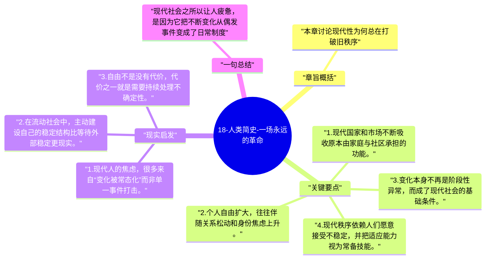

# 18-人类简史-一场永远的革命

现代社会最突出的体验之一，是变化永不停歇。赫拉利把这种状态称为“一场永远的革命”：制度、身份、家庭、职业和价值都在持续重组。

## 章旨概括

本章讨论现代性为何总在打破旧秩序。市场与国家联手重塑家庭、社区和传统角色，个人获得了更多自由，也承担了更多不确定性。现代人不像前人那样被单一共同体牢牢定义，却也因此更容易在流动中失去稳定感。赫拉利认为，这种持续变化已经成为现代社会的常态结构。

## 关键要点

1. 现代国家和市场不断吸收原本由家庭与社区承担的功能。
2. 个人自由扩大，往往伴随关系松动和身份焦虑上升。
3. 变化本身不再是阶段性异常，而成了现代社会的基础条件。
4. 现代秩序依赖人们愿意接受不稳定，并把适应能力视为常备技能。

## 现实启发

1. 现代人的焦虑，很多来自“变化被常态化”而非单一事件打击。
2. 在流动社会中，主动建设自己的稳定结构比等待外部稳定更现实。
3. 自由不是没有代价，代价之一就是需要持续处理不确定性。

## 一句总结

现代社会之所以让人疲惫，是因为它把不断变化从偶发事件变成了日常制度。

---

## Mermaid 思维导图

### 图1

