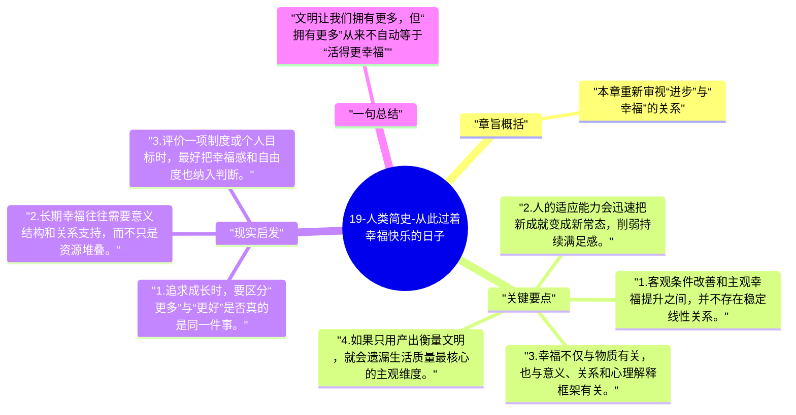

# 19-人类简史-从此过着幸福快乐的日子

经历了这么多革命之后，赫拉利提出一个直击人心的问题：人类真的更幸福了吗。答案并不简单，因为财富、权力和技术增长，并不会自动转化成稳定的幸福感。

## 章旨概括

本章重新审视“进步”与“幸福”的关系。赫拉利指出，人的主观幸福很大程度上受生化机制、预期管理和意义感影响，而不是仅由客观条件决定。现代生活确实让人更安全、更富足，却未必让人更满足。幸福因此成为理解文明代价时无法绕开的终点问题。

## 关键要点

1. 客观条件改善和主观幸福提升之间，并不存在稳定线性关系。
2. 人的适应能力会迅速把新成就变成新常态，削弱持续满足感。
3. 幸福不仅与物质有关，也与意义、关系和心理解释框架有关。
4. 如果只用产出衡量文明，就会遗漏生活质量最核心的主观维度。

## 现实启发

1. 追求成长时，要区分“更多”与“更好”是否真的是同一件事。
2. 长期幸福往往需要意义结构和关系支持，而不只是资源堆叠。
3. 评价一项制度或个人目标时，最好把幸福感和自由度也纳入判断。

## 一句总结

文明让我们拥有更多，但“拥有更多”从来不自动等于“活得更幸福”。

---

## Mermaid 思维导图

### 图1

