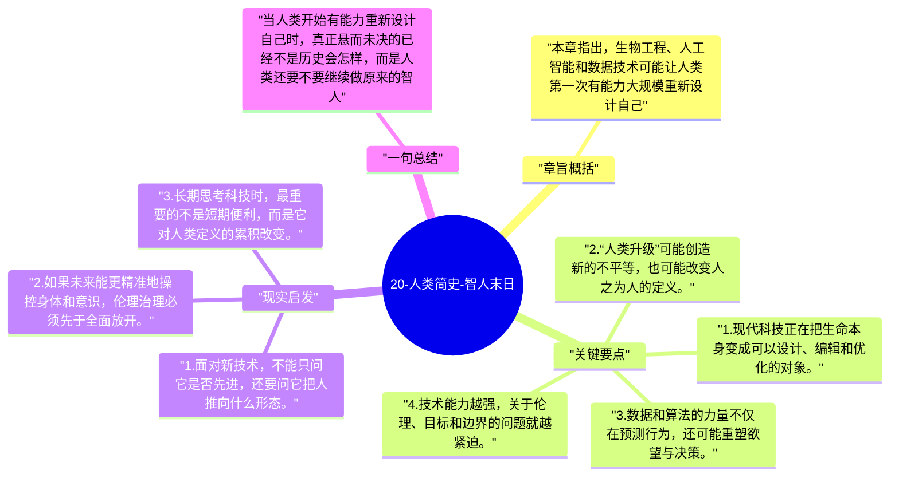

# 20-人类简史-智人末日

最后一章把问题抛向未来：如果人类已经能改写生命本身，那么“智人”这种存在形态是否会被新的生命形式取代。全书也在这里从历史哲学转向未来哲学。

## 章旨概括

本章指出，生物工程、人工智能和数据技术可能让人类第一次有能力大规模重新设计自己。过去我们改造的是环境和制度，未来可能改造的是意识、身体和欲望结构本身。赫拉利因此提醒，真正需要思考的问题不只是“我们能做什么”，而是“当我们什么都能改时，还想成为什么”。

## 关键要点

1. 现代科技正在把生命本身变成可以设计、编辑和优化的对象。
2. “人类升级”可能创造新的不平等，也可能改变人之为人的定义。
3. 数据和算法的力量不仅在预测行为，还可能重塑欲望与决策。
4. 技术能力越强，关于伦理、目标和边界的问题就越紧迫。

## 现实启发

1. 面对新技术，不能只问它是否先进，还要问它把人推向什么形态。
2. 如果未来能更精准地操控身体和意识，伦理治理必须先于全面放开。
3. 长期思考科技时，最重要的不是短期便利，而是它对人类定义的累积改变。

## 一句总结

当人类开始有能力重新设计自己时，真正悬而未决的已经不是历史会怎样，而是人类还要不要继续做原来的智人。

---

## Mermaid 思维导图

### 图1

