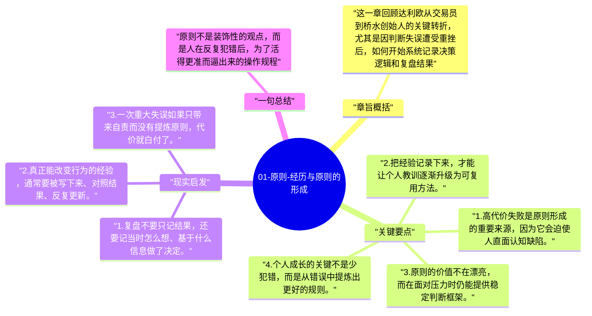

# 01-原则-经历与原则的形成

全书起点不是抽象理论，而是达利欧自己的犯错史。正是那些高代价错误，让他意识到靠感觉行事远远不够，必须把经验提炼成可复用的原则。

## 章旨概括

这一章回顾达利欧从交易员到桥水创始人的关键转折，尤其是因判断失误遭受重挫后，如何开始系统记录决策逻辑和复盘结果。原则不是天生正确的格言，而是从现实反馈里打磨出来的行为准则。达利欧借此说明，真正可靠的原则往往诞生于痛苦、冲突和长期修正，而不是一时顿悟。

## 关键要点

1. 高代价失败是原则形成的重要来源，因为它会迫使人直面认知缺陷。
2. 把经验记录下来，才能让个人教训逐渐升级为可复用方法。
3. 原则的价值不在漂亮，而在面对压力时仍能提供稳定判断框架。
4. 个人成长的关键不是少犯错，而是从错误中提炼出更好的规则。

## 现实启发

1. 复盘不要只记结果，还要记当时怎么想、基于什么信息做了决定。
2. 真正能改变行为的经验，通常要被写下来、对照结果、反复更新。
3. 一次重大失误如果只带来自责而没有提炼原则，代价就白付了。

## 一句总结

原则不是装饰性的观点，而是人在反复犯错后，为了活得更准而逼出来的操作规程。

---

## Mermaid 思维导图

### 图1

