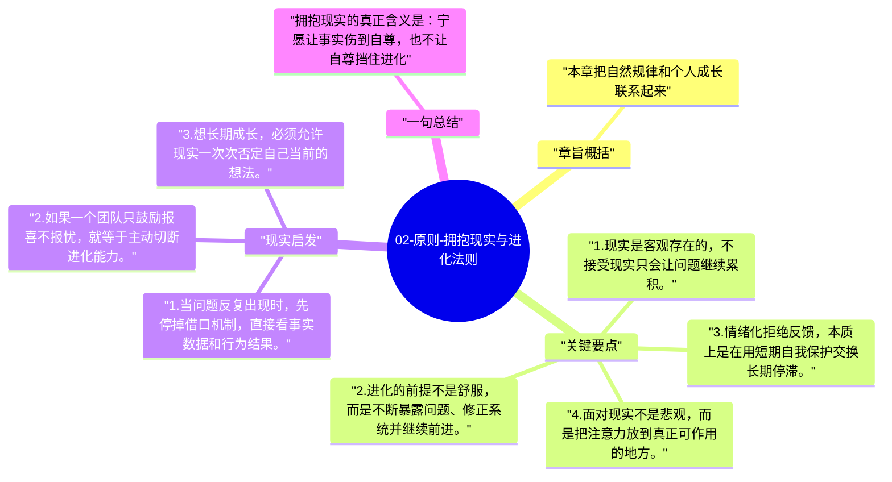

# 02-原则-拥抱现实与进化法则

达利欧最底层的信念之一是：现实不会因为你的情绪而改变，所以真正有效的做法是先面对现实，再决定怎么应对。这里的“进化”不是口号，而是不断适应反馈的过程。

## 章旨概括

本章把自然规律和个人成长联系起来。达利欧认为，生活像一个不断演化的系统，成功来自看清现实、接受反馈、持续优化，而不是维护自尊或逃避问题。只有愿意承认现实比自己重要，人才能真正进入成长通道。原则因此首先是一种现实主义姿态。

## 关键要点

1. 现实是客观存在的，不接受现实只会让问题继续累积。
2. 进化的前提不是舒服，而是不断暴露问题、修正系统并继续前进。
3. 情绪化拒绝反馈，本质上是在用短期自我保护交换长期停滞。
4. 面对现实不是悲观，而是把注意力放到真正可作用的地方。

## 现实启发

1. 当问题反复出现时，先停掉借口机制，直接看事实数据和行为结果。
2. 如果一个团队只鼓励报喜不报忧，就等于主动切断进化能力。
3. 想长期成长，必须允许现实一次次否定自己当前的想法。

## 一句总结

拥抱现实的真正含义是：宁愿让事实伤到自尊，也不让自尊挡住进化。

---

## Mermaid 思维导图

### 图1

