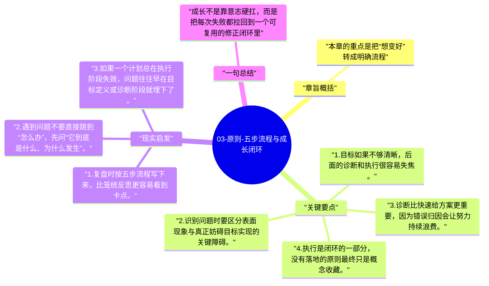

# 03-原则-五步流程与成长闭环

达利欧把成长过程整理成一个非常实用的闭环：设定目标、识别问题、诊断原因、设计方案、推进执行。它像一套可反复迭代的成长流水线。

## 章旨概括

本章的重点是把“想变好”转成明确流程。很多人失败后只停留在情绪层面，没有把问题拆解到可修复的层级。五步流程的价值在于，它迫使人把挫败感转化为结构化行动，从而让失败不再只是打击，而成为改进系统的输入信号。

## 关键要点

1. 目标如果不够清晰，后面的诊断和执行很容易失焦。
2. 识别问题时要区分表面现象与真正妨碍目标实现的关键障碍。
3. 诊断比快速给方案更重要，因为错误归因会让努力持续浪费。
4. 执行是闭环的一部分，没有落地的原则最终只是概念收藏。

## 现实启发

1. 复盘时按五步流程写下来，比笼统反思更容易看到卡点。
2. 遇到问题不要直接跳到“怎么办”，先问“它到底是什么、为什么发生”。
3. 如果一个计划总在执行阶段失效，问题往往早在目标定义或诊断阶段就埋下了。

## 一句总结

成长不是靠意志硬扛，而是把每次失败都拉回到一个可复用的修正闭环里。

---

## Mermaid 思维导图

### 图1

