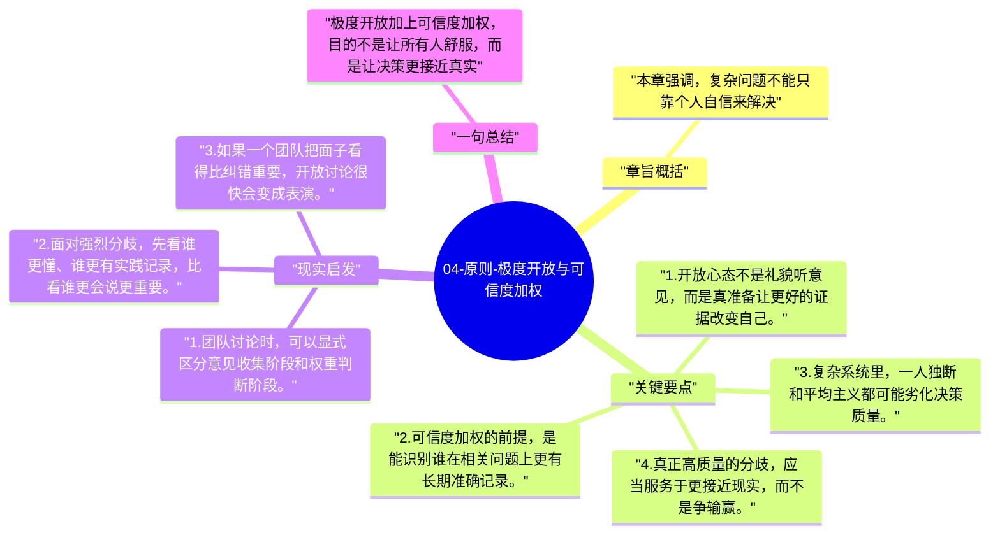

# 04-原则-极度开放与可信度加权

这一章把《原则》中最具辨识度的方法放到一起：极度开放，以及可信度加权决策。它们共同解决的是一个问题：如何减少“我觉得”对重大决策的绑架。

## 章旨概括

本章强调，复杂问题不能只靠个人自信来解决。极度开放要求人主动接纳可能推翻自己的意见，可信度加权则进一步要求区分“每个人都可以发言”和“每个人的判断权重相同”这两件事。达利欧希望借此把决策从情绪、防御和职位权威中解放出来，让更接近事实的人拥有更高影响力。

## 关键要点

1. 开放心态不是礼貌听意见，而是真准备让更好的证据改变自己。
2. 可信度加权的前提，是能识别谁在相关问题上更有长期准确记录。
3. 复杂系统里，一人独断和平均主义都可能劣化决策质量。
4. 真正高质量的分歧，应当服务于更接近现实，而不是争输赢。

## 现实启发

1. 团队讨论时，可以显式区分意见收集阶段和权重判断阶段。
2. 面对强烈分歧，先看谁更懂、谁更有实践记录，比看谁更会说更重要。
3. 如果一个团队把面子看得比纠错重要，开放讨论很快会变成表演。

## 一句总结

极度开放加上可信度加权，目的不是让所有人舒服，而是让决策更接近真实。

---

## Mermaid 思维导图

### 图1

