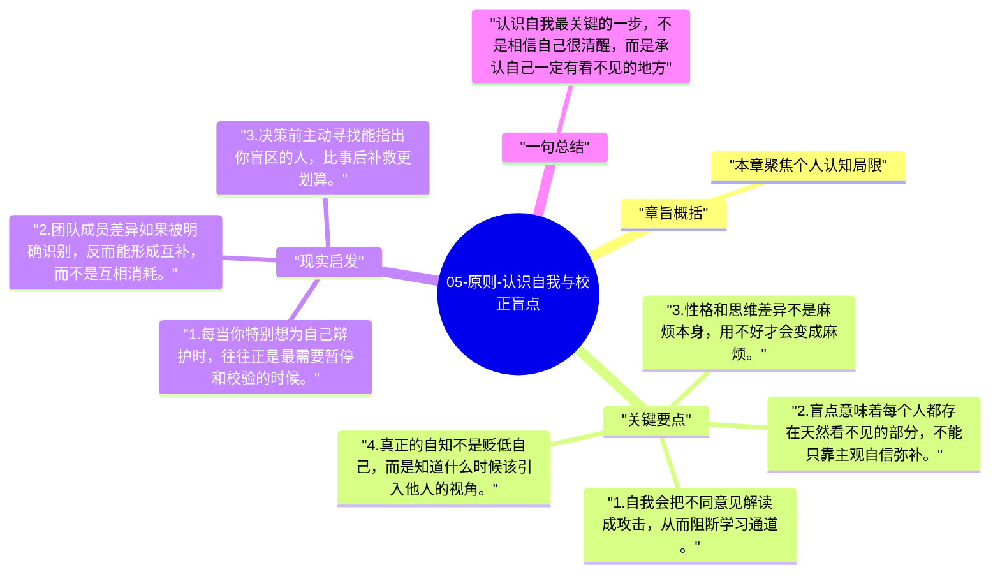

# 05-原则-认识自我与校正盲点

达利欧反复强调，真正难管的不是市场，也不是别人，而是自己。人的自我、防御和盲点，会在关键时刻悄悄劫持判断。

## 章旨概括

本章聚焦个人认知局限。达利欧认为，很多人不是缺少信息，而是不愿承认自己看不到全部。自我会让人排斥反对意见，盲点会让人天然忽略某些重要因素。认识到自己并不总是对的，才可能建立更稳定的决策结构和合作关系。

## 关键要点

1. 自我会把不同意见解读成攻击，从而阻断学习通道。
2. 盲点意味着每个人都存在天然看不见的部分，不能只靠主观自信弥补。
3. 性格和思维差异不是麻烦本身，用不好才会变成麻烦。
4. 真正的自知不是贬低自己，而是知道什么时候该引入他人的视角。

## 现实启发

1. 每当你特别想为自己辩护时，往往正是最需要暂停和校验的时候。
2. 团队成员差异如果被明确识别，反而能形成互补，而不是互相消耗。
3. 决策前主动寻找能指出你盲区的人，比事后补救更划算。

## 一句总结

认识自我最关键的一步，不是相信自己很清醒，而是承认自己一定有看不见的地方。

---

## Mermaid 思维导图

### 图1

