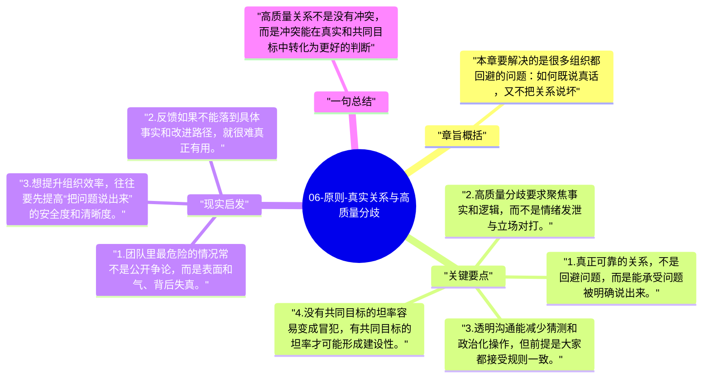

# 06-原则-真实关系与高质量分歧

进入工作原则后，达利欧把“有意义的工作关系”放在极高位置。他认为，真正高绩效的团队不是回避冲突，而是在真实、透明和共同目标下把冲突变成更高质量的讨论。

## 章旨概括

本章要解决的是很多组织都回避的问题：如何既说真话，又不把关系说坏。达利欧提出，关系的可靠性来自真实，而不是客套；高质量分歧的价值，在于逼近事实，而不是证明谁更聪明。只有当团队成员都愿意围绕共同目标接受坦率反馈，分歧才会从伤害关系变成提升系统的工具。

## 关键要点

1. 真正可靠的关系，不是回避问题，而是能承受问题被明确说出来。
2. 高质量分歧要求聚焦事实和逻辑，而不是情绪发泄与立场对打。
3. 透明沟通能减少猜测和政治化操作，但前提是大家都接受规则一致。
4. 没有共同目标的坦率容易变成冒犯，有共同目标的坦率才可能形成建设性。

## 现实启发

1. 团队里最危险的情况常不是公开争论，而是表面和气、背后失真。
2. 反馈如果不能落到具体事实和改进路径，就很难真正有用。
3. 想提升组织效率，往往要先提高“把问题说出来”的安全度和清晰度。

## 一句总结

高质量关系不是没有冲突，而是冲突能在真实和共同目标中转化为更好的判断。

---

## Mermaid 思维导图

### 图1

