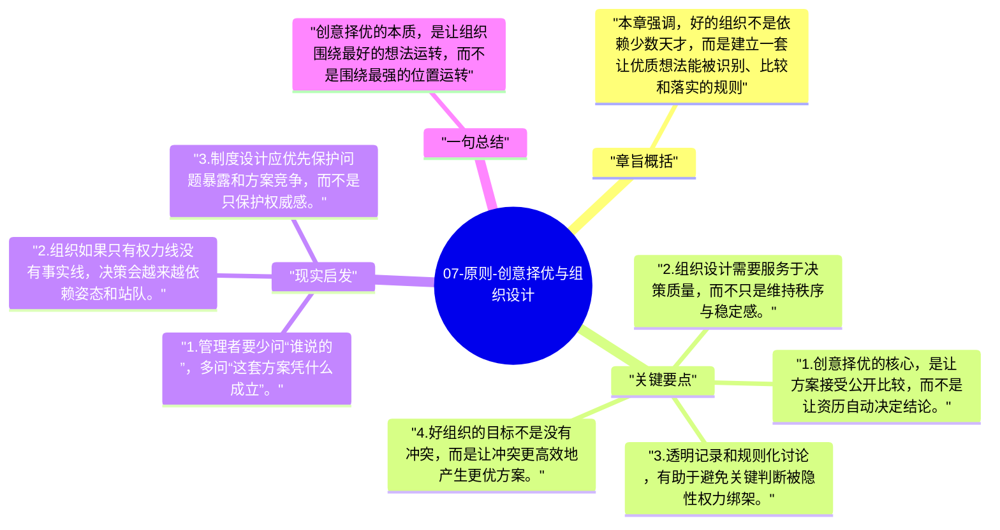

# 07-原则-创意择优与组织设计

这一章把达利欧的组织理想进一步制度化：不是职位高的人一定赢，也不是多数人一定赢，而是让更好的点子赢。为此，组织本身必须被设计成支持创意择优的结构。

## 章旨概括

本章强调，好的组织不是依赖少数天才，而是建立一套让优质想法能被识别、比较和落实的规则。创意择优要求信息尽量透明、分歧尽量充分、决策权尽量与可信度匹配。达利欧希望通过这种设计，减少官僚习气和人情拍板，让组织真正围绕问题本身运转。

## 关键要点

1. 创意择优的核心，是让方案接受公开比较，而不是让资历自动决定结论。
2. 组织设计需要服务于决策质量，而不只是维持秩序与稳定感。
3. 透明记录和规则化讨论，有助于避免关键判断被隐性权力绑架。
4. 好组织的目标不是没有冲突，而是让冲突更高效地产生更优方案。

## 现实启发

1. 管理者要少问“谁说的”，多问“这套方案凭什么成立”。
2. 组织如果只有权力线没有事实线，决策会越来越依赖姿态和站队。
3. 制度设计应优先保护问题暴露和方案竞争，而不是只保护权威感。

## 一句总结

创意择优的本质，是让组织围绕最好的想法运转，而不是围绕最强的位置运转。

---

## Mermaid 思维导图

### 图1

