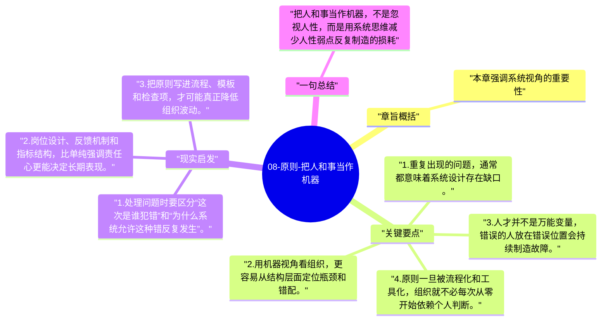

# 08-原则-把人和事当作机器

达利欧最容易被误解的一句话，是“把自己和组织当作机器”。它并不是让人变冷，而是要求人在复杂系统里学会从结构和流程层面看问题。

## 章旨概括

本章强调系统视角的重要性。一个组织出问题，不应只停留在责怪个人，而要追问流程、角色、激励和协同结构哪里设计不当。把人和事当作机器，意味着把结果看成系统输出，把改进重点放在零件匹配和流程迭代上。这样做能显著提高问题修复的可持续性。

## 关键要点

1. 重复出现的问题，通常都意味着系统设计存在缺口。
2. 用机器视角看组织，更容易从结构层面定位瓶颈和错配。
3. 人才并不是万能变量，错误的人放在错误位置会持续制造故障。
4. 原则一旦被流程化和工具化，组织就不必每次从零开始依赖个人判断。

## 现实启发

1. 处理问题时要区分“这次是谁犯错”和“为什么系统允许这种错反复发生”。
2. 岗位设计、反馈机制和指标结构，比单纯强调责任心更能决定长期表现。
3. 把原则写进流程、模板和检查项，才可能真正降低组织波动。

## 一句总结

把人和事当作机器，不是忽视人性，而是用系统思维减少人性弱点反复制造的损耗。

---

## Mermaid 思维导图

### 图1

