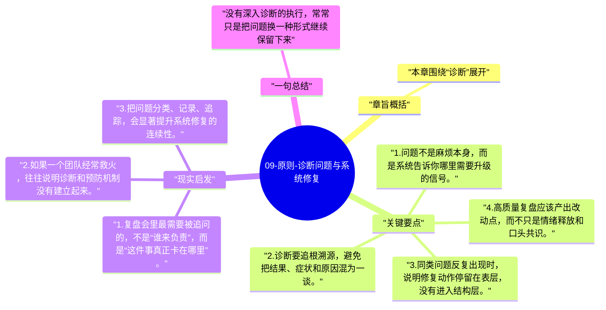

# 09-原则-诊断问题与系统修复

当问题暴露出来之后，达利欧最强调的不是赶紧推进下一步，而是先把问题诊断清楚。很多组织并不是真的执行差，而是一直在错误归因下忙碌。

## 章旨概括

本章围绕“诊断”展开。达利欧认为，问题本身是改进系统最重要的线索，真正的管理不是遮盖问题，而是把问题变成可定位、可解释、可修复的结构缺陷。诊断越准确，修复越可能有效；诊断越模糊，执行越容易沦为重复消耗。系统修复因此必须先于情绪反应和责任甩锅。

## 关键要点

1. 问题不是麻烦本身，而是系统告诉你哪里需要升级的信号。
2. 诊断要追根溯源，避免把结果、症状和原因混为一谈。
3. 同类问题反复出现时，说明修复动作停留在表层，没有进入结构层。
4. 高质量复盘应该产出改动点，而不只是情绪释放和口头共识。

## 现实启发

1. 复盘会里最需要被追问的，不是“谁来负责”，而是“这件事真正卡在哪里”。
2. 如果一个团队经常救火，往往说明诊断和预防机制没有建立起来。
3. 把问题分类、记录、追踪，会显著提升系统修复的连续性。

## 一句总结

没有深入诊断的执行，常常只是把问题换一种形式继续保留下来。

---

## Mermaid 思维导图

### 图1

