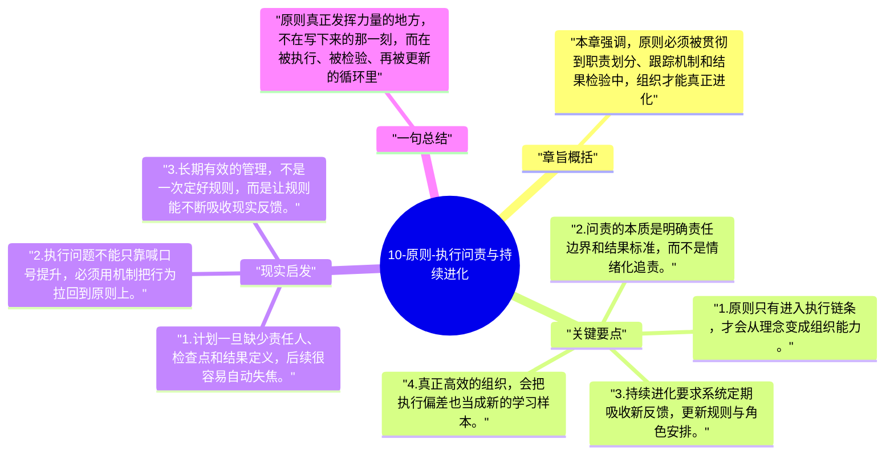

# 10-原则-执行问责与持续进化

全书最后落回一个现实问题：再好的原则，如果不能执行、不能追责、不能持续迭代，最终也只是漂亮文档。达利欧因此把执行和进化看成原则系统闭环的终点。

## 章旨概括

本章强调，原则必须被贯彻到职责划分、跟踪机制和结果检验中，组织才能真正进化。问责的目的不是惩罚，而是明确谁负责什么、结果如何衡量、偏差如何纠正。持续进化则要求组织不断把新经验写回系统，避免原则停留在旧版本。执行力因此不是最后补充，而是原则能否活下去的关键。

## 关键要点

1. 原则只有进入执行链条，才会从理念变成组织能力。
2. 问责的本质是明确责任边界和结果标准，而不是情绪化追责。
3. 持续进化要求系统定期吸收新反馈，更新规则与角色安排。
4. 真正高效的组织，会把执行偏差也当成新的学习样本。

## 现实启发

1. 计划一旦缺少责任人、检查点和结果定义，后续很容易自动失焦。
2. 执行问题不能只靠喊口号提升，必须用机制把行为拉回到原则上。
3. 长期有效的管理，不是一次定好规则，而是让规则能不断吸收现实反馈。

## 一句总结

原则真正发挥力量的地方，不在写下来的那一刻，而在被执行、被检验、再被更新的循环里。

---

## Mermaid 思维导图

### 图1

