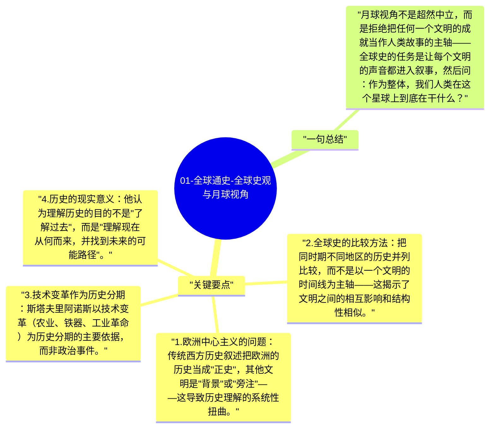

# 01-全球通史-全球史观与月球视角

斯塔夫里阿诺斯在前言中提出了一个思想实验：如果一个生物站在月球上观察地球上的人类历史，它看到的会是什么？不是"西方文明的伟大成就"，而是全人类在地球上展开的一个整体故事。这个"月球视角"是《全球通史》区别于传统西方史学的核心方法论。

## 关键要点

1. **欧洲中心主义的问题**：传统西方历史叙述把欧洲的历史当成"正史"，其他文明是"背景"或"旁注"——这导致历史理解的系统性扭曲。
2. **全球史的比较方法**：把同时期不同地区的历史并列比较，而不是以一个文明的时间线为主轴——这揭示了文明之间的相互影响和结构性相似。
3. **技术变革作为历史分期**：斯塔夫里阿诺斯以技术变革（农业、铁器、工业革命）为历史分期的主要依据，而非政治事件。
4. **历史的现实意义**：他认为理解历史的目的不是"了解过去"，而是"理解现在从何而来，并找到未来的可能路径"。
5. **人类的整体性**：在所有历史叙述中，他始终强调人类作为整体面临共同问题（气候、资源、技术），因此需要全球性的解决方案。

## 一句总结

月球视角不是超然中立，而是拒绝把任何一个文明的成就当作人类故事的主轴——全球史的任务是让每个文明的声音都进入叙事，然后问：作为整体，我们人类在这个星球上到底在干什么？

---

## Mermaid 思维导图

### 图1

