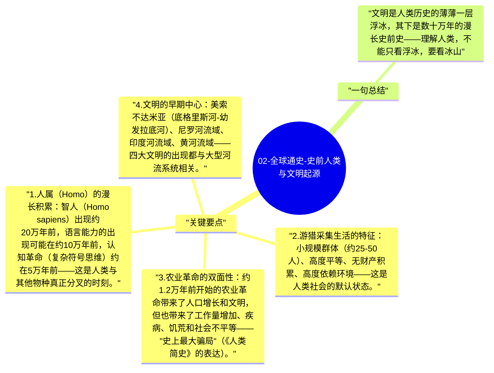

# 02-全球通史-史前人类与文明起源

人类在地球上已经存在了约300万年，但"文明"（以城市、文字、国家为标志）仅在5500年前才出现。这意味着人类99%以上的历史，是在没有文明的状态下度过的。理解这段漫长的史前时期，是理解人类本质的起点。

## 关键要点

1. **人属（Homo）的漫长积累**：智人（Homo sapiens）出现约20万年前，语言能力的出现可能在约10万年前，认知革命（复杂符号思维）约在5万年前——这是人类与其他物种真正分叉的时刻。
2. **游猎采集生活的特征**：小规模群体（约25-50人）、高度平等、无财产积累、高度依赖环境——这是人类社会的默认状态。
3. **农业革命的双面性**：约1.2万年前开始的农业革命带来了人口增长和文明，但也带来了工作量增加、疾病、饥荒和社会不平等——"史上最大骗局"（《人类简史》的表达）。
4. **文明的早期中心**：美索不达米亚（底格里斯河-幼发拉底河）、尼罗河流域、印度河流域、黄河流域——四大文明的出现都与大型河流系统相关。
5. **各文明起源的相似性**：不同地区的文明起源有显著相似性（农业→剩余→分工→文字→政府），但时间和具体形式不同，反映了人类适应不同环境的多样策略。

## 一句总结

文明是人类历史的薄薄一层浮冰，其下是数十万年的漫长史前史——理解人类，不能只看浮冰，要看冰山。

---

## Mermaid 思维导图

### 图1

