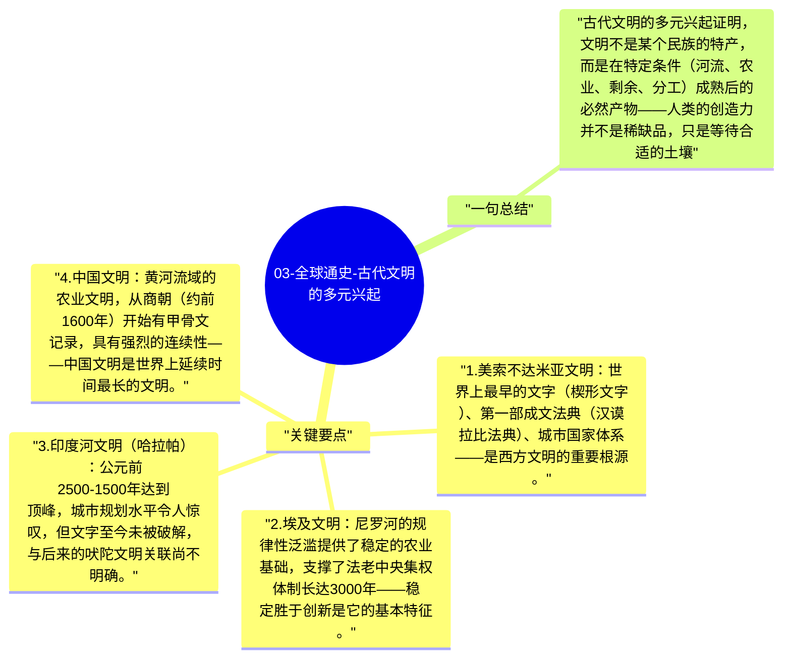

# 03-全球通史-古代文明的多元兴起

在公元前3000年到公元前500年之间，世界各地出现了多个相对独立的文明中心。斯塔夫里阿诺斯的贡献是平等对待这些文明，而不是以某一个为标准，这让我们能看到文明发展的共性规律和各自的特殊路径。

## 关键要点

1. **美索不达米亚文明**：世界上最早的文字（楔形文字）、第一部成文法典（汉谟拉比法典）、城市国家体系——是西方文明的重要根源。
2. **埃及文明**：尼罗河的规律性泛滥提供了稳定的农业基础，支撑了法老中央集权体制长达3000年——稳定胜于创新是它的基本特征。
3. **印度河文明（哈拉帕）**：公元前2500-1500年达到顶峰，城市规划水平令人惊叹，但文字至今未被破解，与后来的吠陀文明关联尚不明确。
4. **中国文明**：黄河流域的农业文明，从商朝（约前1600年）开始有甲骨文记录，具有强烈的连续性——中国文明是世界上延续时间最长的文明。
5. **文明发展的共性**：所有早期文明都有城市、分工专业化、记录系统（文字）、宗教-政治权威和剩余农业生产——这是文明的最小必要条件组合。

## 一句总结

古代文明的多元兴起证明，文明不是某个民族的特产，而是在特定条件（河流、农业、剩余、分工）成熟后的必然产物——人类的创造力并不是稀缺品，只是等待合适的土壤。

---

## Mermaid 思维导图

### 图1

