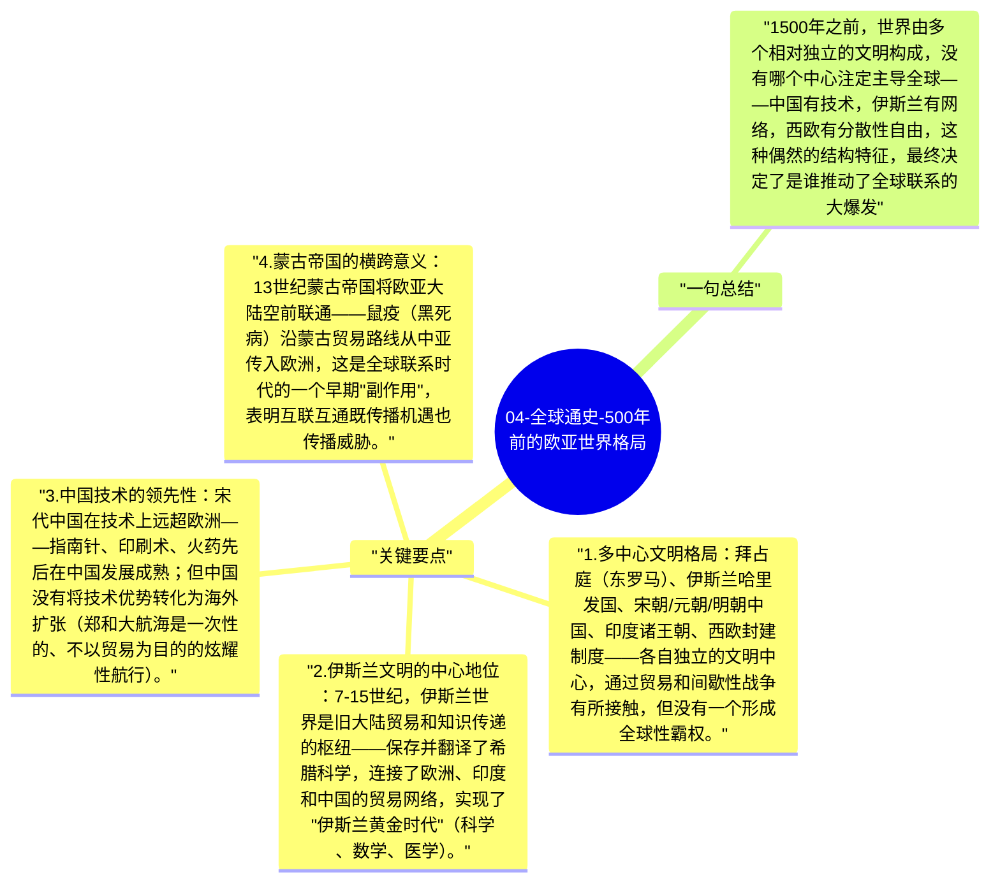

# 04-全球通史-500年前的欧亚世界格局

斯塔夫里阿诺斯将公元前后到1500年的历史分为"欧亚旧世界"的多个文明圈，各自相对独立但有丝绸之路式的间接联系。这一时期各文明内部成就卓越，但尚未形成真正的全球性联系。

## 关键要点

1. **多中心文明格局**：拜占庭（东罗马）、伊斯兰哈里发国、宋朝/元朝/明朝中国、印度诸王朝、西欧封建制度——各自独立的文明中心，通过贸易和间歇性战争有所接触，但没有一个形成全球性霸权。
2. **伊斯兰文明的中心地位**：7-15世纪，伊斯兰世界是旧大陆贸易和知识传递的枢纽——保存并翻译了希腊科学，连接了欧洲、印度和中国的贸易网络，实现了"伊斯兰黄金时代"（科学、数学、医学）。
3. **中国技术的领先性**：宋代中国在技术上远超欧洲——指南针、印刷术、火药先后在中国发展成熟；但中国没有将技术优势转化为海外扩张（郑和大航海是一次性的、不以贸易为目的的炫耀性航行）。
4. **蒙古帝国的横跨意义**：13世纪蒙古帝国将欧亚大陆空前联通——鼠疫（黑死病）沿蒙古贸易路线从中亚传入欧洲，这是全球联系时代的一个早期"副作用"，表明互联互通既传播机遇也传播威胁。
5. **西欧的后起特征**：1500年前的西欧在技术和文化上并不领先，但拥有几个后来发挥关键作用的结构特征：分散的政治权力（无法压制商业活动）、商人阶级的相对自由、对外海洋条件的天然优势。

## 一句总结

1500年之前，世界由多个相对独立的文明构成，没有哪个中心注定主导全球——中国有技术，伊斯兰有网络，西欧有分散性自由，这种偶然的结构特征，最终决定了是谁推动了全球联系的大爆发。

---

## Mermaid 思维导图

### 图1

