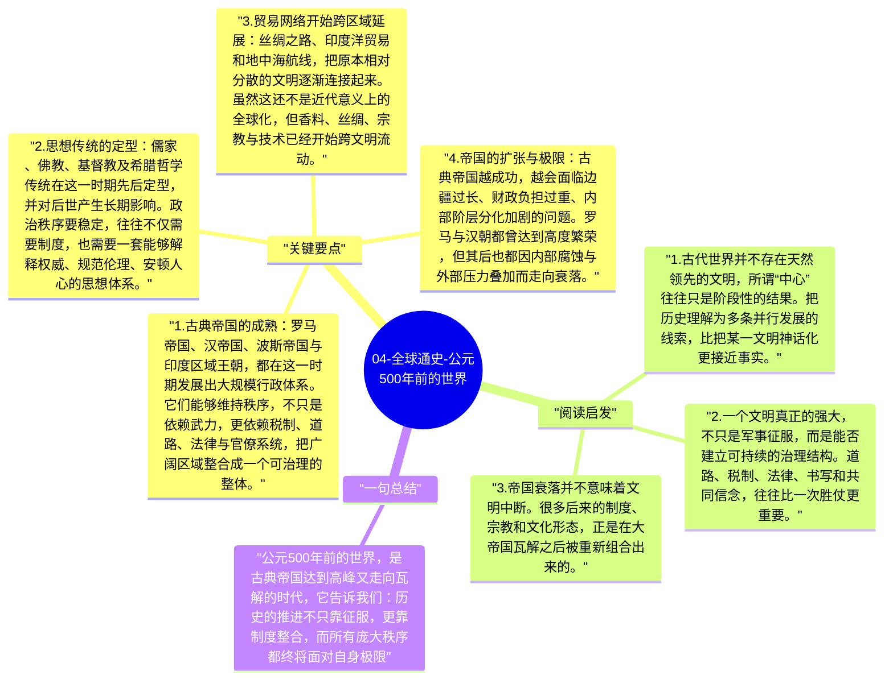

# 04-全球通史-公元500年前的世界

公元500年前后的世界，并不是某一个文明单线推进的故事，而是多个古典文明在不同地理空间中同时发展、碰撞并重组的阶段。斯塔夫里阿诺斯强调，理解这一时期的关键，不是寻找唯一的中心，而是看到罗马、汉帝国、波斯、印度诸王朝等文明如何分别回答国家治理、文化整合与边疆压力这些共同问题。

## 关键要点

1. **古典帝国的成熟**：罗马帝国、汉帝国、波斯帝国与印度区域王朝，都在这一时期发展出大规模行政体系。它们能够维持秩序，不只是依赖武力，更依赖税制、道路、法律与官僚系统，把广阔区域整合成一个可治理的整体。
2. **思想传统的定型**：儒家、佛教、基督教及希腊哲学传统在这一时期先后定型，并对后世产生长期影响。政治秩序要稳定，往往不仅需要制度，也需要一套能够解释权威、规范伦理、安顿人心的思想体系。
3. **贸易网络开始跨区域延展**：丝绸之路、印度洋贸易和地中海航线，把原本相对分散的文明逐渐连接起来。虽然这还不是近代意义上的全球化，但香料、丝绸、宗教与技术已经开始跨文明流动。
4. **帝国的扩张与极限**：古典帝国越成功，越会面临边疆过长、财政负担过重、内部阶层分化加剧的问题。罗马与汉朝都曾达到高度繁荣，但其后也都因内部腐蚀与外部压力叠加而走向衰落。
5. **崩溃不是终点，而是重组的开始**：公元500年前后的大规模动荡，表面上是帝国瓦解，实质上是旧秩序无法继续承载新的社会力量。蛮族迁徙、地方割据、宗教扩张和区域政权重建，共同塑造了后来的中世纪世界。

## 阅读启发

1. 古代世界并不存在天然领先的文明，所谓“中心”往往只是阶段性的结果。把历史理解为多条并行发展的线索，比把某一文明神话化更接近事实。
2. 一个文明真正的强大，不只是军事征服，而是能否建立可持续的治理结构。道路、税制、法律、书写和共同信念，往往比一次胜仗更重要。
3. 帝国衰落并不意味着文明中断。很多后来的制度、宗教和文化形态，正是在大帝国瓦解之后被重新组合出来的。

## 一句总结

公元500年前的世界，是古典帝国达到高峰又走向瓦解的时代，它告诉我们：历史的推进不只靠征服，更靠制度整合，而所有庞大秩序都终将面对自身极限。

---

## Mermaid 思维导图

### 图1

