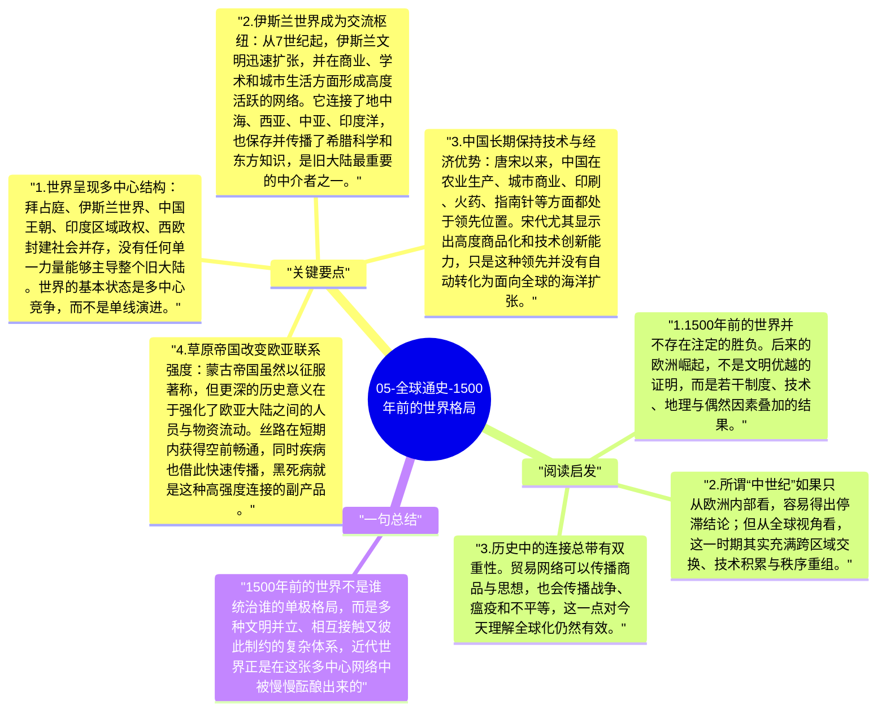

# 05-全球通史-1500年前的世界格局

公元500年至1500年之间的世界，常被旧式历史叙述称为“中世纪”，仿佛这是一个停滞或黑暗的阶段。但从《全球通史》的视角看，这一千年恰恰是多个区域文明重新组合、彼此连接、逐步酝酿近代世界的关键时期。真正重要的问题不是“谁最先进”，而是谁在不同区域中积累了改变世界格局的结构条件。

## 关键要点

1. **世界呈现多中心结构**：拜占庭、伊斯兰世界、中国王朝、印度区域政权、西欧封建社会并存，没有任何单一力量能够主导整个旧大陆。世界的基本状态是多中心竞争，而不是单线演进。
2. **伊斯兰世界成为交流枢纽**：从7世纪起，伊斯兰文明迅速扩张，并在商业、学术和城市生活方面形成高度活跃的网络。它连接了地中海、西亚、中亚、印度洋，也保存并传播了希腊科学和东方知识，是旧大陆最重要的中介者之一。
3. **中国长期保持技术与经济优势**：唐宋以来，中国在农业生产、城市商业、印刷、火药、指南针等方面都处于领先位置。宋代尤其显示出高度商品化和技术创新能力，只是这种领先并没有自动转化为面向全球的海洋扩张。
4. **草原帝国改变欧亚联系强度**：蒙古帝国虽然以征服著称，但更深的历史意义在于强化了欧亚大陆之间的人员与物资流动。丝路在短期内获得空前畅通，同时疾病也借此快速传播，黑死病就是这种高强度连接的副产品。
5. **欧洲的后起条件正在形成**：1500年前的欧洲并不领先，但它拥有分散的政治结构、不断竞争的城邦与王权、相对自主的商人阶层，以及面向大西洋的地理条件。这些看似零散的因素，后来共同促成了欧洲的海上突破。

## 阅读启发

1. 1500年前的世界并不存在注定的胜负。后来的欧洲崛起，不是文明优越的证明，而是若干制度、技术、地理与偶然因素叠加的结果。
2. 所谓“中世纪”如果只从欧洲内部看，容易得出停滞结论；但从全球视角看，这一时期其实充满跨区域交换、技术积累与秩序重组。
3. 历史中的连接总带有双重性。贸易网络可以传播商品与思想，也会传播战争、瘟疫和不平等，这一点对今天理解全球化仍然有效。

## 一句总结

1500年前的世界不是谁统治谁的单极格局，而是多种文明并立、相互接触又彼此制约的复杂体系，近代世界正是在这张多中心网络中被慢慢酝酿出来的。

---

## Mermaid 思维导图

### 图1

