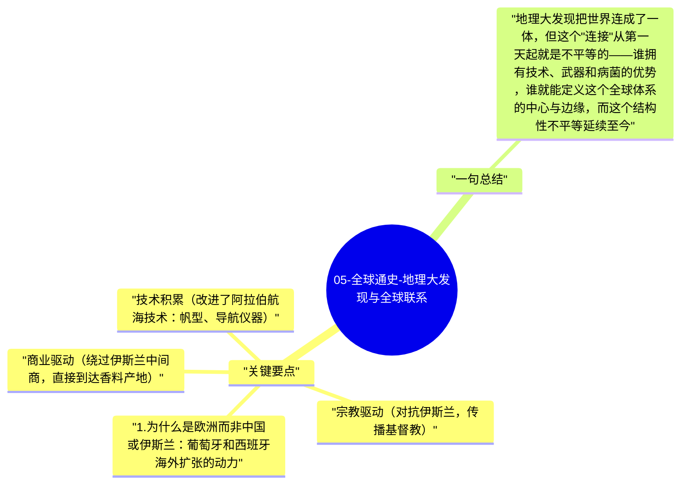

# 05-全球通史-地理大发现与全球联系

1500年前后，欧洲人的海外扩张开启了真正意义上的全球史——美洲的"发现"、大西洋贸易网络的建立、哥伦布大交换，将之前相互隔绝的大陆永久连接起来。这不只是地理发现，而是世界体系的根本重构。

## 关键要点

1. **为什么是欧洲而非中国或伊斯兰**：葡萄牙和西班牙海外扩张的动力：
   - 宗教驱动（对抗伊斯兰，传播基督教）
   - 商业驱动（绕过伊斯兰中间商，直接到达香料产地）
   - 技术积累（改进了阿拉伯航海技术：帆型、导航仪器）
   - 政治结构（国家支持私人海上冒险——风险共担的制度）
2. **哥伦布大交换（Columbian Exchange）**：美洲带给欧亚：马铃薯、玉米、番茄、可可——影响了欧洲的人口增长和饮食革命；欧亚带给美洲：疾病（天花、麻疹）——消灭了美洲90%的原住民，这是人类历史上最大的人口灾难之一。
3. **白银与全球贸易**：美洲的白银（波托西银矿）流向欧洲，再流向中国（中国需要白银缴税）——形成了第一个真正的全球贸易网络；西班牙帝国依赖白银输血，但长期来看通货膨胀侵蚀了竞争力。
4. **奴隶贸易的全球后果**：大西洋奴隶贸易（约1500-1850年）将约1200万非洲人运往美洲——既是人类史上最大规模的强制移民，也深刻塑造了美洲的经济基础（种植园经济）和非洲社会（长期政治不稳定）。
5. **欧洲中心与全球边缘的形成**：世界体系理论（沃勒斯坦）：全球化从一开始就是不平等的——核心（欧洲）从边缘（美洲、非洲、亚洲）提取资源和劳动力；"全球联系"和"全球不平等"同时诞生。

## 一句总结

地理大发现把世界连成了一体，但这个"连接"从第一天起就是不平等的——谁拥有技术、武器和病菌的优势，谁就能定义这个全球体系的中心与边缘，而这个结构性不平等延续至今。

---

## Mermaid 思维导图

### 图1

