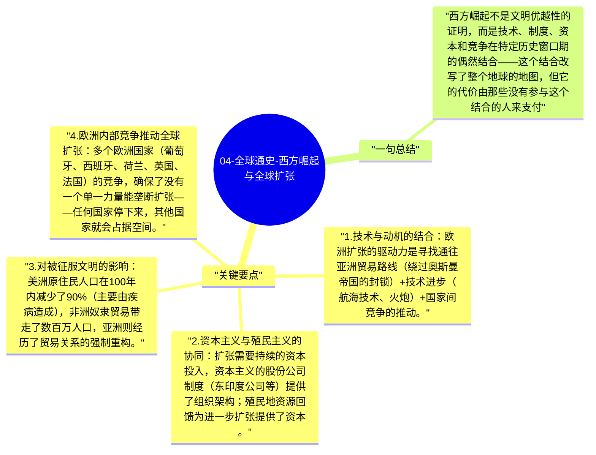

# 04-全球通史-西方崛起与全球扩张

1500年前后，西欧开始了一场改变世界格局的扩张运动。大航海、殖民体系和资本主义的结合，使欧洲文明在300年内从一个相对落后的地区性文明，变成了真正的全球主导力量。这个过程的内部逻辑，是理解现代世界格局的关键。

## 关键要点

1. **技术与动机的结合**：欧洲扩张的驱动力是寻找通往亚洲贸易路线（绕过奥斯曼帝国的封锁）+技术进步（航海技术、火炮）+国家间竞争的推动。
2. **资本主义与殖民主义的协同**：扩张需要持续的资本投入，资本主义的股份公司制度（东印度公司等）提供了组织架构；殖民地资源回馈为进一步扩张提供了资本。
3. **对被征服文明的影响**：美洲原住民人口在100年内减少了90%（主要由疾病造成），非洲奴隶贸易带走了数百万人口，亚洲则经历了贸易关系的强制重构。
4. **欧洲内部竞争推动全球扩张**：多个欧洲国家（葡萄牙、西班牙、荷兰、英国、法国）的竞争，确保了没有一个单一力量能垄断扩张——任何国家停下来，其他国家就会占据空间。
5. **现代世界不平等的根源**：今日世界的经济格局（哪些地区富裕、哪些地区贫穷）在很大程度上是这段殖民历史的结果——斯塔夫里阿诺斯强调，理解不平等必须理解这段历史。

## 一句总结

西方崛起不是文明优越性的证明，而是技术、制度、资本和竞争在特定历史窗口期的偶然结合——这个结合改写了整个地球的地图，但它的代价由那些没有参与这个结合的人来支付。

---

## Mermaid 思维导图

### 图1

