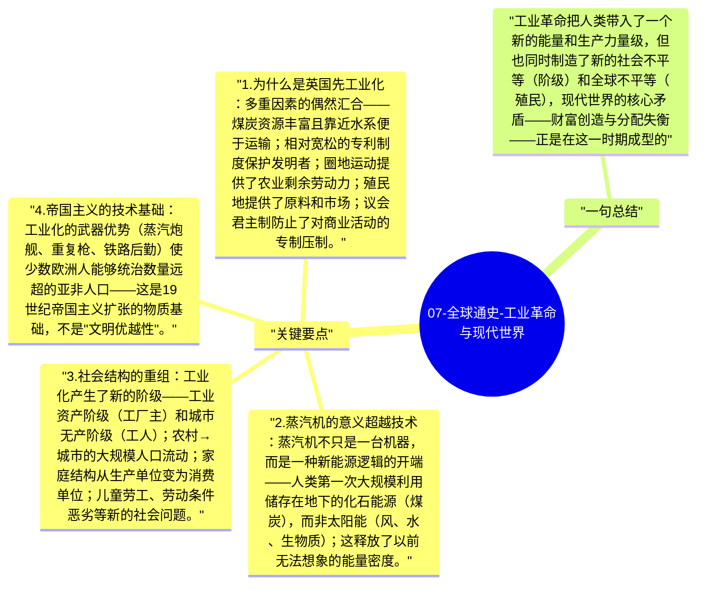

# 07-全球通史-工业革命与现代世界

18-19世纪的工业革命是人类历史上最大的经济和社会转变：从农业和手工业为基础的生活方式，转向机器、工厂和矿山主导的现代经济。工业化首先在英国出现，随后扩展到欧洲、北美，最终成为全球性力量。

## 关键要点

1. **为什么是英国先工业化**：多重因素的偶然汇合——煤炭资源丰富且靠近水系便于运输；相对宽松的专利制度保护发明者；圈地运动提供了农业剩余劳动力；殖民地提供了原料和市场；议会君主制防止了对商业活动的专制压制。
2. **蒸汽机的意义超越技术**：蒸汽机不只是一台机器，而是一种新能源逻辑的开端——人类第一次大规模利用储存在地下的化石能源（煤炭），而非太阳能（风、水、生物质）；这释放了以前无法想象的能量密度。
3. **社会结构的重组**：工业化产生了新的阶级——工业资产阶级（工厂主）和城市无产阶级（工人）；农村→城市的大规模人口流动；家庭结构从生产单位变为消费单位；儿童劳工、劳动条件恶劣等新的社会问题。
4. **帝国主义的技术基础**：工业化的武器优势（蒸汽炮舰、重复枪、铁路后勤）使少数欧洲人能够统治数量远超的亚非人口——这是19世纪帝国主义扩张的物质基础，不是"文明优越性"。
5. **工业化的全球不均衡**：欧洲工业化 = 亚非拉去工业化——英国棉纺织品摧毁了印度的纺织业；鸦片战争强迫中国接受不平等贸易——"现代化"的全球扩散，最初以殖民地形式出现，是一个受强制的过程。

## 一句总结

工业革命把人类带入了一个新的能量和生产力量级，但也同时制造了新的社会不平等（阶级）和全球不平等（殖民），现代世界的核心矛盾——财富创造与分配失衡——正是在这一时期成型的。

---

## Mermaid 思维导图

### 图1

