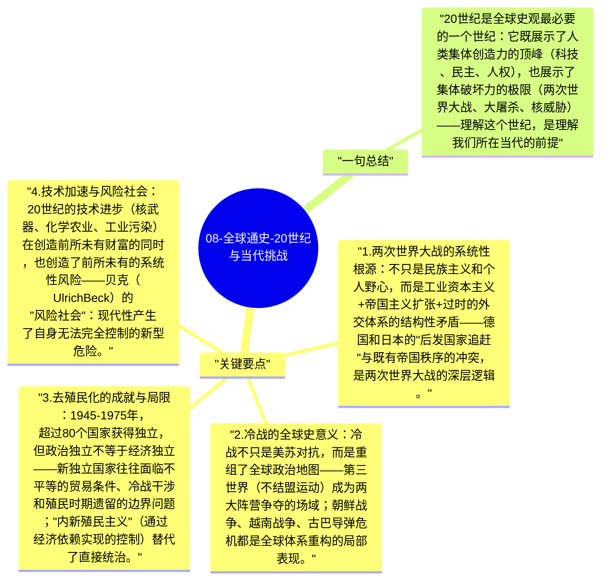

# 08-全球通史-20世纪与当代挑战

20世纪是人类历史上最动荡也是变化最快的世纪：两次世界大战、大萧条、冷战、去殖民化浪潮、技术加速、全球化——斯塔夫里阿诺斯用"全球史观"来审视这个世纪，特别关注非西方世界的反抗与觉醒。

## 关键要点

1. **两次世界大战的系统性根源**：不只是民族主义和个人野心，而是工业资本主义+帝国主义扩张+过时的外交体系的结构性矛盾——德国和日本的"后发国家追赶"与既有帝国秩序的冲突，是两次世界大战的深层逻辑。
2. **冷战的全球史意义**：冷战不只是美苏对抗，而是重组了全球政治地图——第三世界（不结盟运动）成为两大阵营争夺的场域；朝鲜战争、越南战争、古巴导弹危机都是全球体系重构的局部表现。
3. **去殖民化的成就与局限**：1945-1975年，超过80个国家获得独立，但政治独立不等于经济独立——新独立国家往往面临不平等的贸易条件、冷战干涉和殖民时期遗留的边界问题；"内新殖民主义"（通过经济依赖实现的控制）替代了直接统治。
4. **技术加速与风险社会**：20世纪的技术进步（核武器、化学农业、工业污染）在创造前所未有财富的同时，也创造了前所未有的系统性风险——贝克（Ulrich Beck）的"风险社会"：现代性产生了自身无法完全控制的新型危险。
5. **21世纪的三大挑战**：斯塔夫里阿诺斯提出：①核战争威胁（人为的意外或冲突）；②环境恶化（资源耗尽、气候变化）；③全球不平等加剧（南北差距、数字鸿沟）——这三个问题在今天仍然是人类的核心挑战。

## 一句总结

20世纪是全球史观最必要的一个世纪：它既展示了人类集体创造力的顶峰（科技、民主、人权），也展示了集体破坏力的极限（两次世界大战、大屠杀、核威胁）——理解这个世纪，是理解我们所在当代的前提。

---

## Mermaid 思维导图

### 图1

