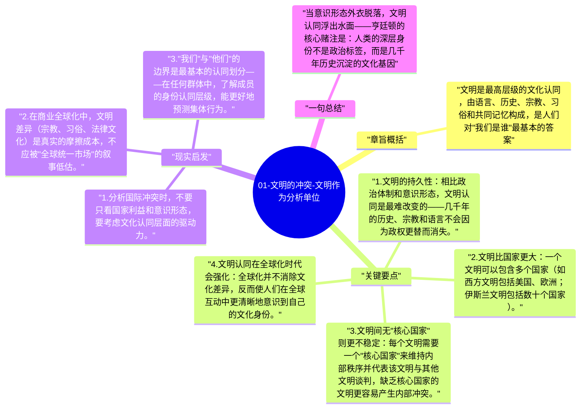

# 01-文明的冲突-文明作为分析单位

冷战结束后，国际关系学界面临一个问题：过去用"意识形态对立"（自由主义 vs 共产主义）来解释世界格局的框架失效了。亨廷顿的回答是：冲突的主要分析单位将从国家和意识形态转移到文明——那些更深层、更持久的文化认同体系。

## 章旨概括

文明是最高层级的文化认同，由语言、历史、宗教、习俗和共同记忆构成，是人们对"我们是谁"最基本的答案。亨廷顿认为，当冷战的意识形态对立消失，文明认同就会成为国际政治中最重要的身份认同——人们会更清楚地问"我来自哪个文明"而不是"我属于哪个意识形态阵营"。

## 关键要点

1. **文明的持久性**：相比政治体制和意识形态，文明认同是最难改变的——几千年的历史、宗教和语言不会因为政权更替而消失。
2. **文明比国家更大**：一个文明可以包含多个国家（如西方文明包括美国、欧洲；伊斯兰文明包括数十个国家）。
3. **文明间无"核心国家"则更不稳定**：每个文明需要一个"核心国家"来维持内部秩序并代表该文明与其他文明谈判，缺乏核心国家的文明更容易产生内部冲突。
4. **文明认同在全球化时代会强化**：全球化并不消除文化差异，反而使人们在全球互动中更清晰地意识到自己的文化身份。
5. **国家身份 vs 文明身份**：国家是政治单位，文明是文化单位——两者经常不一致（如印度包含多种文明因素；西方文明跨越多个国家）。

## 现实启发

1. 分析国际冲突时，不要只看国家利益和意识形态，要考虑文化认同层面的驱动力。
2. 在商业全球化中，文明差异（宗教、习俗、法律文化）是真实的摩擦成本，不应被"全球统一市场"的叙事低估。
3. "我们"与"他们"的边界是最基本的认同划分——在任何群体中，了解成员的身份认同层级，能更好地预测集体行为。

## 一句总结

当意识形态外衣脱落，文明认同浮出水面——亨廷顿的核心赌注是：人类的深层身份不是政治标签，而是几千年历史沉淀的文化基因。

---

## Mermaid 思维导图

### 图1

