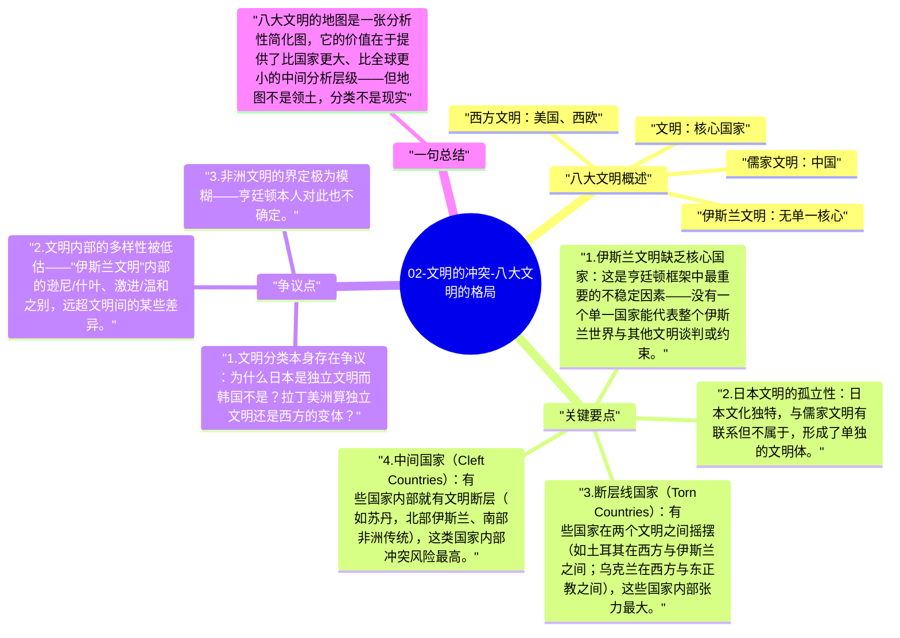

# 02-文明的冲突-八大文明的格局

亨廷顿将冷战后的世界划分为八个主要文明，每个文明都有其核心国家、地理范围和内部结构。这个分类不是学术标准答案，而是用来分析文明间互动的分析性工具。

## 八大文明概述

| 文明 | 核心国家 | 主要地区 | 核心特征 |
|------|---------|---------|---------|
| 西方文明 | 美国、西欧 | 北美、西欧、澳洲 | 基督教、民主、个人主义、法治 |
| 儒家文明 | 中国 | 东亚 | 儒家伦理、集体主义、国家权威 |
| 伊斯兰文明 | 无单一核心 | 中东、北非、东南亚 | 伊斯兰教、乌玛共同体 |
| 印度文明 | 印度 | 南亚次大陆 | 印度教、种姓制度、多元共存 |
| 东正教文明 | 俄罗斯 | 俄罗斯、东欧 | 东正教、集体主义、国家中心 |
| 拉丁美洲文明 | 巴西/阿根廷 | 中南美洲 | 天主教、威权传统、混合文化 |
| 非洲文明 | 南非（潜在） | 撒哈拉以南非洲 | 部落认同、基督教+传统信仰 |
| 日本文明 | 日本（孤立） | 日本列岛 | 独特的文化综合体 |

## 关键要点

1. **伊斯兰文明缺乏核心国家**：这是亨廷顿框架中最重要的不稳定因素——没有一个单一国家能代表整个伊斯兰世界与其他文明谈判或约束。
2. **日本文明的孤立性**：日本文化独特，与儒家文明有联系但不属于，形成了单独的文明体。
3. **断层线国家（Torn Countries）**：有些国家在两个文明之间摇摆（如土耳其在西方与伊斯兰之间；乌克兰在西方与东正教之间），这些国家内部张力最大。
4. **中间国家（Cleft Countries）**：有些国家内部就有文明断层（如苏丹，北部伊斯兰、南部非洲传统），这类国家内部冲突风险最高。
5. **文明地图非静态**：文明的边界会随时间变化，文明内部也有巨大多样性——地图是分析工具，不是固定边界。

## 争议点

1. 文明分类本身存在争议：为什么日本是独立文明而韩国不是？拉丁美洲算独立文明还是西方的变体？
2. 文明内部的多样性被低估——"伊斯兰文明"内部的逊尼/什叶、激进/温和之别，远超文明间的某些差异。
3. 非洲文明的界定极为模糊——亨廷顿本人对此也不确定。

## 一句总结

八大文明的地图是一张分析性简化图，它的价值在于提供了比国家更大、比全球更小的中间分析层级——但地图不是领土，分类不是现实。

---

## Mermaid 思维导图

### 图1

