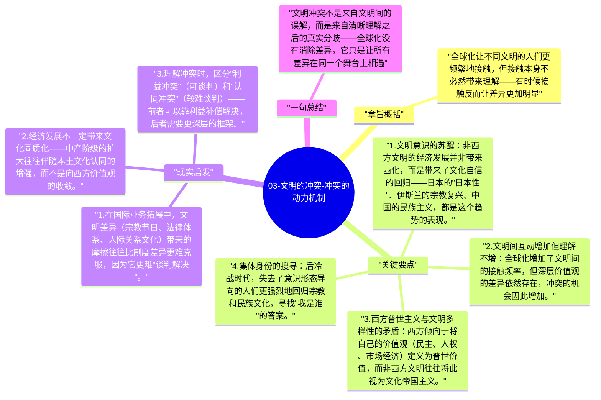

# 03-文明的冲突-冲突的动力机制

亨廷顿认为文明间冲突会增加，原因不是偶然或个人恩怨，而是来自几个系统性的结构动力。理解这些动力，才能理解为什么冷战后世界并未走向"历史终结"，而是出现了新的断层线冲突。

## 章旨概括

全球化让不同文明的人们更频繁地接触，但接触本身不必然带来理解——有时候接触反而让差异更加明显。经济发展让非西方社会有了资源，但发展带来的是本地文化自信的回归，而不是西方化。亨廷顿认为这两个趋势共同提高了文明间紧张关系的烈度。

## 关键要点

1. **文明意识的苏醒**：非西方文明的经济发展并非带来西化，而是带来了文化自信的回归——日本的"日本性"、伊斯兰的宗教复兴、中国的民族主义，都是这个趋势的表现。
2. **文明间互动增加但理解不增**：全球化增加了文明间的接触频率，但深层价值观的差异依然存在，冲突的机会因此增加。
3. **西方普世主义与文明多样性的矛盾**：西方倾向于将自己的价值观（民主、人权、市场经济）定义为普世价值，而非西方文明往往将此视为文化帝国主义。
4. **集体身份的搜寻**：后冷战时代，失去了意识形态导向的人们更强烈地回归宗教和民族文化，寻找"我是谁"的答案。
5. **断层线战争的特征**：文明断层线上的冲突（如波黑、车臣、印巴边境）往往更持久、更难谈判解决，因为双方都在进行文化认同的捍卫，而非单纯的领土或利益争夺。

## 现实启发

1. 在国际业务拓展中，文明差异（宗教节日、法律体系、人际关系文化）带来的摩擦往往比制度差异更难克服，因为它更难"谈判解决"。
2. 经济发展不一定带来文化同质化——中产阶级的扩大往往伴随本土文化认同的增强，而不是向西方价值观的收敛。
3. 理解冲突时，区分"利益冲突"（可谈判）和"认同冲突"（较难谈判）——前者可以靠利益补偿解决，后者需要更深层的框架。

## 一句总结

文明冲突不是来自文明间的误解，而是来自清晰理解之后的真实分歧——全球化没有消除差异，它只是让所有差异在同一个舞台上相遇。

---

## Mermaid 思维导图

### 图1

