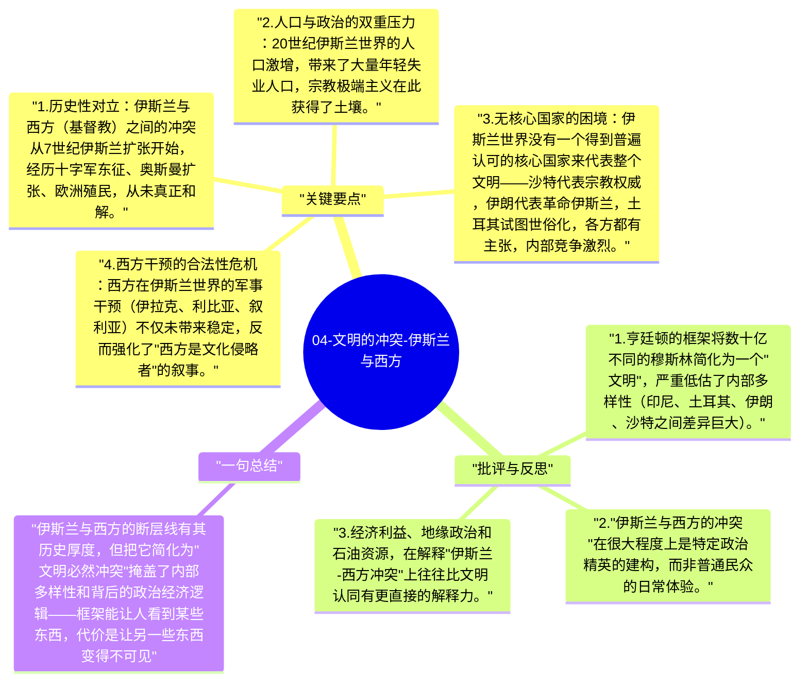

# 04-文明的冲突-伊斯兰与西方

亨廷顿认为，伊斯兰文明与西方文明之间的断层线是冷战后世界最主要、最持久的冲突轴线。这条断层线不是新产生的，而是有着1400年的历史积累。

## 关键要点

1. **历史性对立**：伊斯兰与西方（基督教）之间的冲突从7世纪伊斯兰扩张开始，经历十字军东征、奥斯曼扩张、欧洲殖民，从未真正和解。
2. **人口与政治的双重压力**：20世纪伊斯兰世界的人口激增，带来了大量年轻失业人口，宗教极端主义在此获得了土壤。
3. **无核心国家的困境**：伊斯兰世界没有一个得到普遍认可的核心国家来代表整个文明——沙特代表宗教权威，伊朗代表革命伊斯兰，土耳其试图世俗化，各方都有主张，内部竞争激烈。
4. **西方干预的合法性危机**：西方在伊斯兰世界的军事干预（伊拉克、利比亚、叙利亚）不仅未带来稳定，反而强化了"西方是文化侵略者"的叙事。
5. **移民与欧洲内部的文明断层**：大规模穆斯林移民进入欧洲，在欧洲内部制造了新的文明断层线，成为欧洲政治的重要议题。

## 批评与反思

1. 亨廷顿的框架将数十亿不同的穆斯林简化为一个"文明"，严重低估了内部多样性（印尼、土耳其、伊朗、沙特之间差异巨大）。
2. "伊斯兰与西方的冲突"在很大程度上是特定政治精英的建构，而非普通民众的日常体验。
3. 经济利益、地缘政治和石油资源，在解释"伊斯兰-西方冲突"上往往比文明认同有更直接的解释力。

## 一句总结

伊斯兰与西方的断层线有其历史厚度，但把它简化为"文明必然冲突"掩盖了内部多样性和背后的政治经济逻辑——框架能让人看到某些东西，代价是让另一些东西变得不可见。

---

## Mermaid 思维导图

### 图1

