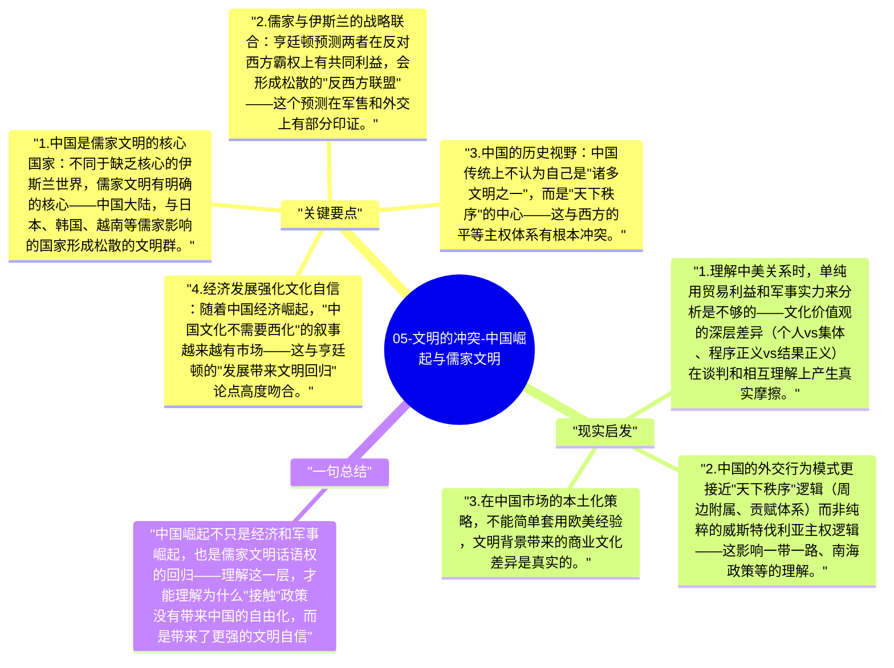

# 05-文明的冲突-中国崛起与儒家文明

亨廷顿在1990年代就预测中国崛起将是21世纪最重要的地缘政治事件，并认为儒家文明与西方文明之间的张力，将与伊斯兰-西方张力并列成为两大主要冲突轴线。

## 关键要点

1. **中国是儒家文明的核心国家**：不同于缺乏核心的伊斯兰世界，儒家文明有明确的核心——中国大陆，与日本、韩国、越南等儒家影响的国家形成松散的文明群。
2. **儒家与伊斯兰的战略联合**：亨廷顿预测两者在反对西方霸权上有共同利益，会形成松散的"反西方联盟"——这个预测在军售和外交上有部分印证。
3. **中国的历史视野**：中国传统上不认为自己是"诸多文明之一"，而是"天下秩序"的中心——这与西方的平等主权体系有根本冲突。
4. **经济发展强化文化自信**：随着中国经济崛起，"中国文化不需要西化"的叙事越来越有市场——这与亨廷顿的"发展带来文明回归"论点高度吻合。
5. **台湾问题的文明维度**：亨廷顿认为台湾是西方-儒家冲突的潜在断层线，因为它涉及西方介入儒家文明的内部争端。

## 现实启发

1. 理解中美关系时，单纯用贸易利益和军事实力来分析是不够的——文化价值观的深层差异（个人 vs 集体、程序正义 vs 结果正义）在谈判和相互理解上产生真实摩擦。
2. 中国的外交行为模式更接近"天下秩序"逻辑（周边附属、贡赋体系）而非纯粹的威斯特伐利亚主权逻辑——这影响一带一路、南海政策等的理解。
3. 在中国市场的本土化策略，不能简单套用欧美经验，文明背景带来的商业文化差异是真实的。

## 一句总结

中国崛起不只是经济和军事崛起，也是儒家文明话语权的回归——理解这一层，才能理解为什么"接触"政策没有带来中国的自由化，而是带来了更强的文明自信。

---

## Mermaid 思维导图

### 图1

